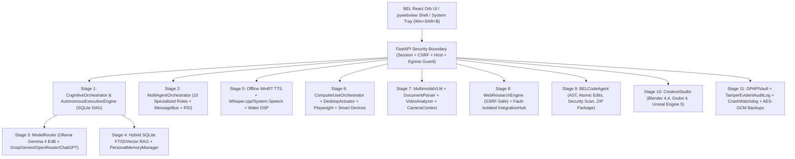

# BEL V1 — Installation, Architecture, Configuration & User Guide
**Version:** 1.0.0-RC1  
**Platform:** Windows 10 / 11 (x64)

---

## 1. System Overview & Architecture

**BEL (Behavioral Executive Logic)** is a local-first personal AI executive assistant for Windows built on the SIGHT/BEL architecture. It combines a FastAPI backend (`sight/sight_core/`), a `pywebview` + Windows system tray desktop shell (`sight/scripts/bel_desktop.py`), and an animated orb React/TypeScript frontend (`frontend/`).



---

## 2. Installation & Startup Instructions

### Prerequisites
- **Operating System:** Windows 10 or Windows 11 (64-bit)
- **Python:** Python 3.12 (`sight/.venv`)
- **Node.js:** Node.js 20+ (for building `frontend/`)
- **Local LLM (Recommended):** [Ollama](https://ollama.com) with `gemma4:e4b-it-qat` pulled (`>= 6 GiB` free system RAM recommended for live local inference)

### Running from Source Checkout
```powershell
# 1. Build the official frontend orb interface
cd frontend
npm ci
npm run build
cd ..

# 2. Start the local runtime and BEL desktop shell
.\Start-Local-Runtime.ps1
.\Start-BEL.ps1
```

### Building the Standalone Windows Release (`BEL.exe`)
If `.cache\needle3` contains the pinned Needle 3 ONNX assets, build the one-folder Windows executable bundle inside `.cache\windows-release`:
```powershell
.\sight\scripts\build_windows.ps1 -OutputDirectory .\.cache\windows-release
```
Keep `BEL.exe`, `BEL-worker.exe`, and `_internal` together in the same folder.

---

## 3. Configuration Guide

BEL stores owner data in `%LOCALAPPDATA%\BEL` (or the directory specified by `BEL_DATA_DIR` / `--data-directory`).

| Environment Variable / Setting | Default | Description |
|---|---|---|
| `BEL_DATA_DIR` | `%LOCALAPPDATA%\BEL` | Root directory for SQLite databases, DPAPI vault, private workspace files, and audit logs. |
| `SIGHT_PORT` | `8080` | Loopback port (`127.0.0.1`) for the authenticated FastAPI backend. |
| `SIGHT_MODEL` | `gemma4:e4b-it-qat` | Default local Ollama model identifier. |
| `SIGHT_LOCAL_TTS` | `true` | Enables offline Windows WinRT / SAPI speech synthesis (`en_bel` and `hi_bel` profiles). |
| `SIGHT_LOCAL_STT` | `false` | Opt-in local speech recognition (`whisper-cpp` or `windows-speech`). |
| `OLLAMA_MODELS` | Auto-discovered | Custom directory for Ollama model blobs and manifests (e.g., `D:\Ollama Models`). |

### Cloud Provider Configuration & Secret Vault
- Cloud providers (`groq`, `gemini`, `openrouter`, `tokenharbor`, `chatgpt`) are **disabled by default**.
- Store API keys securely in the Windows DPAPI hardware-backed vault via Settings or `POST /api/security/vault/store`.
- Configure provider budgets, rate limits, and free-tier enforcement via `POST /api/models/configure` (requires explicit owner approval token).

---

## 4. Key API Endpoints Reference

All endpoints require an authenticated owner session cookie (`sight_session`), and all `POST` endpoints require the `x-sight-csrf` header.

- **Core Chat & Utterance:** `POST /api/bel/chat`, `POST /api/utterance`, `WS /ws/app`
- **Autonomous Execution Engine (Stage 1):** `POST /api/autonomous/tasks`, `GET /api/autonomous/tasks/{task_id}`, `POST /api/autonomous/tasks/{task_id}/run`, `POST /api/autonomous/tasks/{task_id}/approve`, `POST /api/autonomous/tasks/{task_id}/cancel`, `GET /api/autonomous/notifications`
- **Multi-Agent Orchestrator (Stage 2):** `GET /api/agents/roles`, `POST /api/agents/execute`, `GET /api/agents/messages`
- **Personal Memory & Briefings (Stage 4):** `POST /api/personal/memory/add`, `GET /api/personal/memory`, `GET /api/personal/memory/contradictions`, `POST /api/personal/memory/export`, `POST /api/personal/memory/restore`, `POST /api/proactive/briefing`
- **Voice & Speaker Privacy (Stage 5):** `GET /api/speech/profiles`, `POST /api/speech/stream_chunks`, `POST /api/speech/speaker/enroll`, `POST /api/speech/speaker/identify`, `POST /api/speech/speaker/purge`
- **Computer Use & Smart Devices (Stage 6):** `POST /api/automation/workflows/save`, `GET /api/automation/workflows`, `POST /api/automation/workflows/{workflow_id}/replay`, `POST /api/devices/discover`, `POST /api/devices/authenticate`, `POST /api/devices/command`
- **Multimodal Intelligence (Stage 7):** `POST /api/multimodal/image/compare`, `POST /api/multimodal/video/analyze`, `POST /api/multimodal/camera/consent`, `POST /api/multimodal/camera/ingest`, `POST /api/multimodal/reason`
- **Web Research & Integrations (Stage 8):** `POST /api/research/query`, `GET /api/integrations/connectors`, `POST /api/integrations/configure`, `POST /api/integrations/invoke`
- **BEL Code (Stage 9):** `GET /api/coding/bel_code/inspect`, `POST /api/coding/bel_code/scan`, `POST /api/coding/bel_code/deliver`, `POST /api/coding/bel_code/package`
- **Creative Studio (Stage 10):** `POST /api/creative/studio/blender_inspect`, `POST /api/creative/studio/godot_package`, `POST /api/creative/studio/unreal_scaffold`
- **Security, Vault & Backups (Stage 11):** `GET /api/security/audit_chain/verify`, `POST /api/security/egress/check`, `POST /api/security/permissions/grant`, `GET /api/security/permissions/check`, `POST /api/security/keys/rotate`, `POST /api/system/backup/create`, `POST /api/system/backup/restore`
