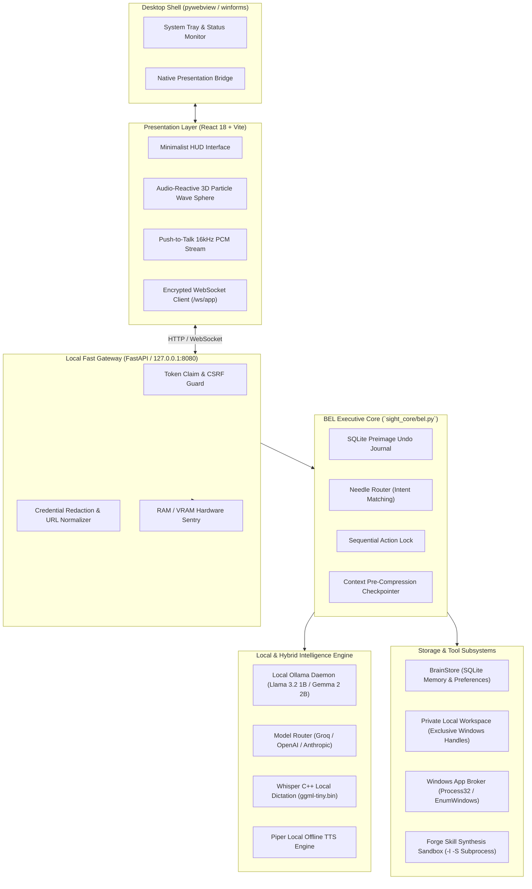

# BEL (Behavioral Executive Logic) — System Architecture

BEL is designed as a multimodal, autonomous-capable personal AI operating system inspired by MCU J.A.R.V.I.S., engineered with a strict **fail-closed, local-first, privacy-by-design** paradigm.

---

## 1. High-Level Architecture Diagram

---

## 2. Architectural Pillars

### 2.1 The Executive Boundary (One Action, Exact Grant)
The AI model has **no direct execution handles**. Every tool proposal emitted by the model generates a cryptographic execution proposal specifying exact normalized parameters. The user must explicitly approve the proposal through the presentation layer. Upon approval, a single-use action ticket is granted and consumed immediately.

### 2.2 Win32 Preimage Journaling & Instant Undo
Before any file mutation (`files.create`, `files.edit`, `files.rename`) takes place on the host filesystem:
1. An exclusive Windows file lock is acquired (`kernel32.CreateFileW` with deny-write/delete flags).
2. The exact pre-image bytes and SHA256 checksum are written to `bel_undo` in SQLite under an active database transaction.
3. The mutation executes and validates post-state SHA256.
4. Any mismatch marks the transaction `unverified` and halts.
5. The user can invoke `files.undo` at any point to restore the exact pre-image bytes.

### 2.3 Hardware Telemetry Sentinel
Because local speech recognition and LLM inference can saturate host RAM on 16GB systems:
- Real-time polling of host RAM, CPU, and GPU VRAM via `psutil` and `pynvml`.
- Hard load-shedding floor: if free host RAM drops below 500 MiB or VRAM below 300 MiB, heavy operations are refused or diverted to cloud fallbacks.

### 2.4 Multimodal Voice Pipeline
- Capture: HTML5 Web Audio API at 16kHz mono PCM, bounded by a 20-second hard cap to prevent memory leaks.
- Recognition: Whisper C++ running quantized `ggml-tiny.bin` offline with Windows Dictation fallback.
- Visual Feedback: Real-time audio waveform drives dynamic vertex displacement on the 3D particle sphere orb.
