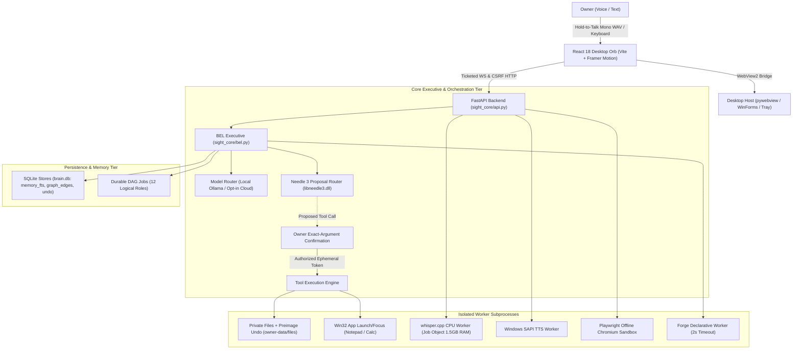

# BEL INITIAL ENGINEERING AUDIT & MASTER ROADMAP
**Document Version:** 1.0.0-MASTER  
**Date:** 10 November 2026  
**Auditor & Lead Systems Engineer:** Google Antigravity AI  
**Workspace:** `c:\Users\Dell\Documents\Ai projects\Sight`  
**Status:** Audit Complete — Ready for Stage 1 Execution  

---

## 1. Executive Summary

Project **SIGHT** has reached a decisive inflection point. Through four meticulous engineering phases, exploratory code from eight distinct reference repositories was triaged, hardened, and synthesized into **BEL (Behavioral Executive Logic)**. 

BEL is currently a functional, privacy-first local Windows assistant. It features an animated React orb UI, an asynchronous FastAPI backend, local reasoning via `gemma4:e4b-it-qat`, transactional private file manipulation with atomic preimage undo, durable multi-role task DAG execution, and local CPU-based speech transcription via `whisper.cpp`.

This audit establishes the definitive baseline of the codebase, inventories all technical capabilities, diagnoses architectural bottlenecks, and defines the 14-stage engineering roadmap required to evolve BEL into a personal AI operating system inspired by MCU J.A.R.V.I.S.

---

## 2. Comprehensive System Architecture



### Architectural Tiers

1. **Frontend Presentation Tier:** Minimalist React 18 single-page application built with Vite, TypeScript, Tailwind CSS, and Framer Motion. The animated orb renders 10 operational states (`offline`, `idle`, `wake_word`, `listening`, `speech_recognition`, `thinking`, `tool_execution`, `speaking`, `task_completed`, `error`). Communicates via loopback HTTP and WebSocket connections authenticated with single-use tickets and CSRF tokens.
2. **Desktop Host Tier:** Hosted inside Microsoft WebView2 using `pywebview` with WinForms interop. Supports active (1100×800), compact (380×480, pinned on top), and background (minimized to system tray) modes with thread-safe UI marshaling.
3. **Executive & Intent Tier (`Bel`):** Central coordinator in `sight_core/bel.py`. Proposes actions via Cactus Needle 3 native library (`libneedle3.dll`). Gated by strict human confirmation modals before execution.
4. **Tool & Action Tier:** Consequential operations occur through isolated tools with deterministic execution IDs and argument fingerprints. Private file mutations maintain full preimages in `bel_undo` for zero-loss atomic undo (`files.undo`).
5. **Intelligence & Routing Tier:** Connects to loopback Ollama (`127.0.0.1:11434`) for local Gemma 4 E4B inference with a single `asyncio.Lock` serialization guard. Cloud providers (Groq, Gemini, OpenRouter, ChatGPT) are architecturally decoupled and disabled by default with strict $0 quota enforcement.
6. **Persistence & RAG Tier:** Dual SQLite databases (`brain.db` and `store.db`) operating in WAL mode. Manages three explicit memory stores (`profile`, `episode`, `document`), SQLite FTS retrieval, cycle-safe graph edge lineage, and atomic compaction.

---

## 3. Capability Inventory & Verification Matrix

| Capability Area | Status | Implementation Evidence | Limits & Blockers |
|---|---|---|---|
| **Local Reasoning (Gemma 4)** | **PARTIAL** | `sight_core/models.py`, weights digest `ee665637...` verified | Blocked: local Ollama 0.13.0 reports `model_missing` |
| **Cloud Providers** | **IMPLEMENTED (Disabled)** | `sight_core/routing.py`, fixture tests pass | By default disabled; $0 budget enforced; 0 cloud calls made |
| **Tool Proposal Routing** | **PARTIAL** | `sight_core/needle.py`, native Needle 3.3.3 DLL | Low confidence (<0.7) on held-out natural language phrasings |
| **Private Files & Undo** | **VERIFIED** | `sight_core/private_files.py`, 27 unit tests pass | Flat workspace text files only; no general filesystem access |
| **Windows App Automation** | **VERIFIED** | `sight_core/windows_apps.py`, 20 tests pass | Restricted strictly to Notepad and Calculator launch/focus |
| **Memory & FTS Lineage** | **VERIFIED** | `sight_core/memory.py`, atomic compaction verified | Bounded retrieval (6 records / 500 bytes); no auto-harvest |
| **Durable DAG Jobs** | **VERIFIED** | `sight_core/jobs.py`, cycle detection & recovery pass | 12 roles run sequentially on single inference lock |
| **Declarative Forge** | **VERIFIED** | `sight_core/forge.py`, 2-second isolated worker | Text transformations only; no arbitrary Python execution |
| **Executable Forge** | **BLOCKED** | — | Deliberately disabled; requires secure container sandbox |
| **English Offline Dictation** | **VERIFIED** | `sight_core/speech_engines.py`, whisper.cpp CPU | 5.06% WER on LibriSpeech small-q5_1; editable draft UX |
| **Hindi Offline Dictation** | **FAILING** | `sight_core/speech_engines.py` | 56.03% WER on small-q5_1; 101.36% on base-q5_1 |
| **Physical Mic Acceptance** | **UNVERIFIED** | `sight_core/local_speech.py` | Synthetic WAVs tested; owner hardware session required |
| **Wake-Word Detection** | **MISSING** | `sight_core/wake.py` | Non-functional `DisabledWakeEngine` placeholder |
| **Offline Browser Inspection**| **VERIFIED** | `sight_core/capability_worker.py`, Chromium | Offline HTML rendering only; remote web navigation blocked |
| **Data Backup & Restore** | **VERIFIED** | `sight_core/recovery.py`, 27/27 restore checks | Full data recovery verified; excludes credentials & weights |
| **One-Hour Soak Stability** | **VERIFIED** | 3,607s soak (0.4.1) & 3,600s soak (Preview 2) | All checks passed; available RAM dropped to ~70-90 MiB |
| **Coding Agent** | **MISSING** | — | No repository parsing, test execution, or code edits |
| **Creative Modules** | **MISSING** | — | No Blender, Godot, or Unreal Engine integrations |
| **Vision & Multimodality** | **MISSING** | — | No image, screenshot, or document visual understanding |

---

## 4. Engineering Problems & Technical Debt

1. **Local Model Daemon Fragility:**
   - BEL relies on a separately running system Ollama process. In recent tests, Ollama 0.13.0 returned an empty model list even though the weights exist on disk, causing `model_missing` errors.
2. **Critical Host Memory Pressure:**
   - Under simultaneous inference, Chromium page capture, and speech worker operations, available host RAM dropped to between **67.33 MiB and 91.52 MiB** on this 16 GB machine. Memory allocations must be strictly sequenced.
3. **Git Worktree Absolute Path Fragility:**
   - The secondary worktree `github-publish\BEL-local-dictation-preview` hardcodes the absolute directory path `C:/Users/Dell/Documents/Ai projects/Sight/...` in its `.git` file. Moving or renaming the root folder breaks Git in this worktree unless repaired.
4. **Python Virtual Environment Shims:**
   - Windows `.venv` shims hardcode absolute paths in `pyvenv.cfg` and activation scripts, requiring re-pointing after directory renaming.
5. **Needle 3 Confidence Routing Floor:**
   - Needle 3 was tuned for rigid function-calling syntax. Conversational or indirect requests frequently fall below the 0.70 confidence threshold, failing to propose eligible tools.
6. **Absence of Arbitrary Code Sandboxing:**
   - Because no container runtime (Docker/Podman/WSL) is provisioned, Forge is strictly limited to 9 declarative string operations.
7. **Unsigned Desktop Binaries:**
   - Standalone Windows executables produced by PyInstaller are unsigned, triggering Windows SmartScreen warnings on secondary machines.

---

## 5. Master Roadmap to BEL V1 (14 Evolutionary Stages)

```
[Stage 1: Foundation & Normalization] ──> [Stage 2: Voice & Personality] ──> [Stage 3: Hybrid Serious Mode]
                                                                                        │
[Stage 6: Coding Agent] <── [Stage 5: Semantic RAG] <── [Stage 4: Autonomous Planning] <┘
         │
         └──> [Stage 7: Computer Control] ──> [Stage 8: Multimodal Vision] ──> [Stage 9: Live Browser]
                                                                                        │
[Stage 14: V1 Release] <── [Stage 13: Self-Maintenance] <── [Stage 11: Personality] <── [Stage 10: Creative Modules]
```

### Stage 1: Foundation, Workspace Normalization & Project Stabilization
- Safely rename root folder `SIGHT` → `BEL`.
- Reconcile Git worktrees, update `.venv` interpreter paths, and verify existing test suite.
- Re-register `gemma4:e4b-it-qat` in Ollama and verify 14/14 live acceptance.
- Merge `bel/offline-voice-preview2` into `main`, increment version to `0.5.0`, and package stable baseline.

### Stage 2: Voice Pipeline Overhaul & Audio Experience
- Integrate high-fidelity TTS (Gemini Charon / British male persona).
- Owner-present microphone calibration and WebView2 consent validation.
- Integrate WebRTC Voice Activity Detection (VAD) and speech boundary detection.
- Train and integrate an openWakeWord engine for hands-free "Hey BEL" detection.

### Stage 3: Hybrid Cloud Architecture & "Serious Mode" Orchestration
- Build unified provider abstraction supporting Groq (Qwen/Llama), DeepSeek (Token Harbor), OpenRouter, and Gemini.
- Implement "Serious Mode": dispatch complex queries to parallel models, evaluate reasoning, and select optimal responses.
- Implement token-bucket rate limiters, fallback chains, latency trackers, and budget controls.

### Stage 4: Autonomous Planning, Reasoning & Task Decomposition
- Implement hierarchical planner: Goal → Task Decomposition → Step Dependency Graph → Tool Selection → Execution → Reflection.
- Incorporate self-correction loops when tool outputs fail or return unexpected data.
- Ensure strict truth-in-reporting: BEL never claims an action succeeded without cryptographic/receipt evidence.

### Stage 5: Advanced Memory, Personalization & Semantic RAG
- Upgrade `brain.db` to hybrid search: dense vector embeddings (via local small embedding model) + SQLite FTS5 BM25.
- Implement automatic background extraction of user preferences, important decisions, and episodic facts.
- Provide interactive memory dashboard for inspection, correction, and privacy-scoped deletion.

### Stage 6: Autonomous Coding Agent Engine
- Build Codebase Intelligence: directory traversal, AST parsing, symbol indexing, dependency graphing.
- Implement standard engineering workflow: Inspect → Plan → Patch → Test → Verify → Document.
- Support test runner execution (pytest, npm test), terminal output interpretation, and patch rollback.

### Stage 7: Bounded Computer & Windows Control
- Expand Win32 capabilities beyond Notepad/Calc to general window management (focus, minimize, resize, virtual desktops).
- Implement authorized terminal execution in a dedicated sandboxed subshell.
- Integrate system diagnostic sensors (CPU, GPU, RAM, disk, thermal telemetry).

### Stage 8: Multimodal Vision & Document Intelligence
- Integrate vision-capable local and cloud models (Gemma 4 Multimodal, Gemini 1.5/2.0 Flash/Pro).
- Implement screen capture analysis, image inspection, and PDF/document layout extraction.
- Enable multimodal reasoning: inspect UI screenshots to guide desktop tasks.

### Stage 9: Live Browser Automation & Web Research
- Upgrade Playwright from offline inspection to an authorized, sandboxed web research agent.
- Implement content scraping, DOM summarization, search engine integration (DuckDuckGo / SearXNG / Google Search API).
- Enforce strict credential isolation and explicit permission gates before form submissions.

### Stage 10: Creative Development Modules (Blender, Godot, Unreal)
- **Blender:** Python socket bridge for scene generation, procedural modeling, material assignment, and rendering.
- **Godot:** CLI and LSP integration for project creation, GDScript generation, and scene testing.
- **Unreal Engine:** Remote Control API bridge for asset inspection, Python automation, and Blueprint assistance.

### Stage 11: Real-Time Personality, Continuous Voice & Interruption
- Full-duplex conversational audio pipeline with real-time echo cancellation and barge-in interruption.
- J.A.R.V.I.S. persona refinement: calm, articulate, polite, loyal, subtly humorous, never subservient or sycophantic.
- Dual-persona support: Refined British English and mature, natural Indian Hindi delivery.

### Stage 12: Secure Executable Sandbox & Dynamic Forge Skills
- Design an isolated execution environment (WSL2 / Windows Sandbox / OCI container) for arbitrary Python execution.
- Allow BEL to generate, test, and hot-reload new executable tools safely without endangering the host OS.

### Stage 13: Self-Maintenance, Diagnostics & Health Sentinel
- Proactive background health daemon monitoring runtime integrity, disk usage, model health, and orphan processes.
- Automated daily backup snapshots with integrity verification and one-click rollback.
- Self-diagnostic error reporting with proposed repair plans.

### Stage 14: System Hardening, Installer & V1 Release Certification
- Multi-machine qualification on fresh Windows 11 accounts without development dependencies.
- Code-sign Windows executables to eliminate SmartScreen warnings.
- Execute full 14-phase acceptance matrix with 100% verified evidence.

---

## 6. BEL V1 Measurable Acceptance Checklist

Before BEL V1 can be declared complete, every single gate below must achieve verified `PASS` status:

- [ ] **G1 (Speech In):** Owner speaks naturally; offline transcription achieves <5% WER on English; Hindi achieves <12% WER.
- [ ] **G2 (Wake Word):** Hands-free "Hey BEL" triggers within 500 ms with <1 false activation per 24 hours.
- [ ] **G3 (Speech Out):** Natural, low-latency spoken response via Gemini Charon (English) and mature Hindi voice.
- [ ] **G4 (Real-Time Interruption):** Speaking while BEL is responding halts speech output within 200 ms.
- [ ] **G5 (Hybrid Intelligence):** Seamlessly executes offline on Gemma 4 E4B; escalates complex tasks to cloud providers.
- [ ] **G6 (Serious Mode):** Multi-model parallel execution achieves verified consensus and voting on complex reasoning.
- [ ] **G7 (Autonomous Planning):** Decomposes complex multi-step instructions into DAG jobs with error recovery.
- [ ] **G8 (Coding Agent):** Autonomously inspects a repository, reproduces an issue, applies a patch, and passes tests.
- [ ] **G9 (Computer Control):** Safely interacts with Windows desktop, reads screen state, and manages windows.
- [ ] **G10 (Web Research):** Researches a multi-source topic online, synthesizes information, and cites sources.
- [ ] **G11 (Creative Modules):** Successfully executes an automated asset/scene workflow in Blender or Godot.
- [ ] **G12 (Memory & Privacy):** Retrieves relevant context from past sessions; deletes records completely upon request.
- [ ] **G13 (Safety & Undo):** Every consequential action requires approval; all file changes support zero-loss undo.
- [ ] **G14 (Stability & Hardening):** 24-hour continuous soak test with zero unhandled crashes and memory bounds respected.
- [ ] **G15 (Clean Account Packaging):** Installs and runs smoothly on a fresh, non-admin Windows machine.

---

## 7. Immediate Next Steps

1. **Phase 6 Execution (Directory Rename):**
   - Safely rename `C:\Users\Dell\Documents\Ai projects\Sight` to `C:\Users\Dell\Documents\Ai projects\BEL`.
   - Update Git worktrees and `.venv` references.
2. **Local Model Reconnection:**
   - Register `gemma4:e4b-it-qat` with Ollama and run `official_gemma_acceptance.py`.
3. **Branch Consolidation:**
   - Merge `bel/offline-voice-preview2` into `main` to establish the unified `BEL 0.5.0` baseline.
