```mermaid
flowchart TD
    subgraph STAGE_1["Stage 1: Stabilization & Hardware Sentry"]
        S1_1["System Hardware Monitor (RAM/VRAM Telemetry)"]
        S1_2["Host Memory Guard & Protective Throttle"]
        S1_3["Ollama Local Model Auto-Lifecycle Management"]
    end

    subgraph STAGE_2["Stage 2: Memory & Context Hardening"]
        S2_1["Context Pre-Compression Checkpointing (Hermes-Style)"]
        S2_2["Background Ephemeral Memory Curator"]
        S2_3["Semantic Graph Association in SQLite"]
    end

    subgraph STAGE_3["Stage 3: Visual & Acoustic Experience"]
        S3_1["3D Particle Wave Sphere Orb (Roamies Golden Spiral)"]
        S3_2["Audio-Reactive Real-time Pulse & Bulge Shader"]
        S3_3["Offline Low-Latency TTS (Piper / Sherpa-ONNX)"]
    end

    subgraph STAGE_4["Stage 4: Autonomous Tooling & Creative Engines"]
        S4_1["Parametric 3D CAD Agent (build123d Integration)"]
        S4_2["Bounded Self-Healing Runtime & Crash Diagnostic"]
        S4_3["Software Engineering Agent & Sandbox Workspaces"]
    end

    subgraph STAGE_5["Stage 5: Multimodal Perception & Computer Automation"]
        S5_1["Screen Observation & Passive Vision Analysis"]
        S5_2["Windows UI Automation Broker"]
        S5_3["Streaming Wake-Word Acoustic Model"]
    end

    subgraph STAGE_6["Stage 6: Packaging, Verification & Release Matrix"]
        S6_1["Single-Binary Desktop Host (pywebview / PyInstaller)"]
        S6_2["Comprehensive Acceptance Matrix Sign-off"]
        S6_3["BEL v1.0.0 Golden Release"]
    end

    STAGE_1 --> STAGE_2
    STAGE_2 --> STAGE_3
    STAGE_3 --> STAGE_4
    STAGE_4 --> STAGE_5
    STAGE_5 --> STAGE_6
```

# BEL (Behavioral Executive Logic) — Master Development Roadmap
**Project Vision:** MCU J.A.R.V.I.S.-inspired intelligent, multimodal, autonomous-capable personal executive assistant.  
**Roadmap Scope:** From Current Baseline (`v0.5.0`) to Full Production (`v1.0.0`).  
**Guiding Engineering Axiom:** *Human life, wellbeing, dignity, and safety always take priority over AI self-preservation.*

---

---

## Stage 1: Stabilization & Host Protection (Priority: IMMEDIATE)
*Objective: Guarantee system stability, prevent host memory exhaustion, and automate local inference lifecycle.*

- [ ] **1.1 Real-Time System Monitor (`sight_core/system_monitor.py`):**
  - Implement real-time host RAM, CPU, and GPU VRAM monitoring using `psutil` and `pynvml` (inspired by A.D.A Pocket AI `system_monitor.py`).
  - Provide `/api/system/telemetry` endpoint broadcasting metrics over WebSocket.
- [ ] **1.2 Memory Sentinel & Load Shedding:**
  - Enforce hard safety ceiling: if available host RAM < 500 MiB or VRAM < 300 MiB, refuse heavy local batch jobs or automatically divert to cloud fallback.
  - Guard against out-of-memory lockups on 16GB host.
- [ ] **1.3 Automated Local Inference Lifecycle:**
  - Detect whether Ollama daemon is running; automatically launch cached portable Ollama (`.cache/preview2/ollama-0.40.9`) on demand and shut down on idle.

---

## Stage 2: Memory Architecture & Context Intelligence (Priority: HIGH)
*Objective: Prevent context loss in extended conversational sessions and curate episodic memory into long-term knowledge.*

- [ ] **2.1 Context Pre-Compression Memory Checkpointing:**
  - Implement Hermes Agent-inspired `on_pre_compress` checkpointing: when conversation context reaches 80% of model window, trigger an automated memory extraction pass before truncation.
  - Store extracted key facts and user decisions into `bel_history` and `brain.sqlite3`.
- [ ] **2.2 Idle Background Memory Curator:**
  - Create a lightweight background task that analyzes recent interactions during idle cycles.
  - Consolidate duplicate records, purge expired TTL memories, and organize user preferences into semantic categories.

---

## Stage 3: Visual Identity & Offline Speech Synthesis (Priority: HIGH)
*Objective: Transition from 2D SVG rings to a high-fidelity MCU-inspired 3D particle wave sphere and enable full offline voice interaction.*

- [ ] **3.1 3D Particle Wave Sphere Orb (`frontend/src/components/Orb.tsx`):**
  - Replace flat SVG rings with a Three.js / WebGL 3D particle sphere using Roamies' 520-point Fibonacci/golden-spiral geometry (`jarvis.js`).
  - Implement radar sweep effect and dynamic vertex displacement driven by audio frequency data from the microphone/audio stream.
  - Maintain clean, minimal ice-blue/cyan aesthetic without cluttered sci-fi dashboards.
- [ ] **3.2 Offline Local Speech Synthesis (TTS):**
  - Implement local neural TTS using Piper or Sherpa-ONNX with a high-quality, lightweight voice model (e.g., `en_US-lessac-medium` or `en_US-amy-medium`).
  - Wire into `/api/speech/synthesize` to eliminate the current 503 "Local TTS is not installed" blocker.

---

## Stage 4: Autonomous Tooling, Creative CAD & Self-Healing (Priority: MEDIUM)
*Objective: Expand executive agent capabilities into engineering, parametric design, and fault-tolerant execution.*

- [ ] **4.1 Parametric 3D CAD Agent Integration:**
  - Adapt ADA V2's `cad_agent.py` architecture: integrate `build123d` or OpenSCAD script generation into a verified BEL capability (`cad.parametric`).
  - Verify STEP/STL export with automated geometry sanity checks and preview artifact rendering.
- [ ] **4.2 Bounded Self-Healing Execution Engine:**
  - Integrate Brahma AI Evo inspired error categorization and self-healing boundary: automatically diagnose runtime exceptions, suggest minimal diffs, and test candidates in sandboxed workers.
  - Enforce `PROTECTED_CORE_FILES` so the AI cannot modify security-critical kernels or permission controllers.

---

## Stage 5: Multimodal Perception & Computer Automation (Priority: MEDIUM)
*Objective: Enable environmental awareness and seamless desktop coordination.*

- [ ] **5.1 Passive Screen Observation & UI Element Grounding:**
  - Safe, privacy-preserving desktop screen capture with region selection.
  - Integrate multimodal VLM grounding for desktop UI inspection without unauthorized click execution.
- [ ] **5.2 Streaming Wake-Word Acoustic Model:**
  - Integrate openWakeWord for continuous low-power "Hey BEL" detection without streaming audio to third parties.

---

## Stage 6: Packaging, Verification & Release Acceptance (Priority: FINAL)
*Objective: Package BEL into an autonomous, self-contained desktop application with complete regression verification.*

- [ ] **6.1 Single-Executable Desktop Host:**
  - Bundle backend, frontend static assets, and portable runtime into a standalone installer or portable binary.
- [ ] **6.2 Full Release Acceptance Matrix Sign-Off:**
  - Verify all 50+ acceptance criteria in `BEL_RELEASE_ACCEPTANCE_MATRIX.md`.
  - Final sign-off for BEL V1.0.0.
