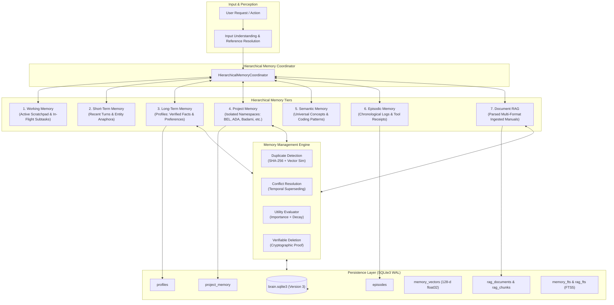

# BEL (Behavioral Executive Logic) — Memory Architecture
## Multi-Tier Cognitive Continuity & Structured Knowledge Retrieval

This document provides the technical specification and architectural blueprint for BEL's unified hierarchical memory system.

---

## 1. Architectural Overview

BEL employs a 7-tier cognitive memory architecture that bridges short-term conversation state with permanent, project-isolated knowledge.

---

## 2. Memory Tier Specifications

### Tier 1: Working Memory
- **Scope:** Transient in-memory state during an active reasoning or task cycle.
- **Components:** In-flight reasoning scratchpad, active subtask status, step counters, and intermediate tool results.
- **Lifecycle:** Cleared or snapshotted upon objective completion. Zero disk overhead for temporary working variables.

### Tier 2: Short-Term Memory
- **Scope:** Immediate conversational session buffer (up to 50 turns).
- **Components:** Rolling conversational turn history (`TurnRecord`), pronoun/anaphora resolution entities (`primary_file`, `last_application`, `last_tool`).
- **Pre-Compression Checkpoint:** At 80% context saturation, an automatic Hermes-style extraction elevates critical facts into long-term memory before sliding the window.

### Tier 3: Long-Term Memory
- **Scope:** Cross-session persistent user preferences, operational guidelines, and validated personal facts.
- **Storage:** `profiles` table in SQLite with cryptographic revision tracking.
- **Privacy Scopes:** `local` (never transmitted outside localhost) and `cloud_allowed` (permitted in remote LLM context prompts).

### Tier 4: Project Memory (Strict Isolation)
- **Scope:** Project-specific technical and architectural knowledge partitioned by unique `project_id` (e.g. `BEL`, `ADA`, `Badami`, `Octo6`).
- **Categories:**
  - `goal`: Project mission, key milestones, and deadlines.
  - `decision`: Architectural decisions, rationales, and alternatives rejected.
  - `architecture`: Subsystem boundaries, module designs, and interface contracts.
  - `choice`: Selected frameworks, libraries, and hardware platforms.
  - `progress`: Completed deliverables and active work items.
  - `issue`: Known bugs, blockers, technical debt, and constraints.
  - `dependency`: Hardware dependencies, external APIs, and library versions.
  - `roadmap`: Long-term evolutionary stages and planned milestones.
  - `file`: Crucial configuration paths, manifests, and scripts.
- **Isolation Guarantee:** Queries targeting one project space **fail-closed** and are strictly prevented from returning or leaking data from another project space.

### Tier 5: Semantic Memory
- **Scope:** Universal technology concepts, coding idioms, algorithm patterns, and factual knowledge.
- **Storage:** Global project space (`project_id='global'`) or specialized semantic stores with dense vector embeddings.

### Tier 6: Episodic Memory
- **Scope:** Immutable chronological execution logs, past tool receipts, task outcomes, and past session summaries.
- **Storage:** `episodes` and `receipts` tables in SQLite, establishing end-to-end auditability and provenance.

### Tier 7: Document RAG Corpus
- **Scope:** External documentation, specification sheets, user guides, and repository source code.
- **Storage:** Multi-format chunked text indexed in `rag_chunks`, `rag_fts` (FTS5), and `memory_vectors`.

---

## 3. Memory Management & Integrity Engine

### 3.1 Composite Utility Scoring
Every stored memory evaluates a continuous utility score $U \in [0.0, 1.0]$:
$$U = 0.5 \cdot \left(\frac{\text{Importance}}{5}\right) + 0.3 \cdot \text{Confidence} + 0.2 \cdot e^{-\ln(2) \cdot \frac{\Delta t}{t_{1/2}}}$$
where:
- $\text{Importance} \in [1, 5]$ (defaults to 3; critical invariants are assigned 5).
- $\text{Confidence} \in [0.0, 1.0]$.
- $\Delta t$ is elapsed time since last access or creation.
- $t_{1/2} = 30\text{ days}$ (exponential half-life).

### 3.2 Duplicate Detection
Incoming records undergo dual-layer deduplication:
1. **Cryptographic Match:** SHA-256 digest comparison against existing project memories.
2. **Semantic Similarity:** Cosine similarity over 128-d dense vectors. If similarity exceeds $0.85\text{--}0.95$ and the incoming item is not marked as an explicit correction, the redundant record is flagged or merged.

### 3.3 Conflict Resolution & Temporal Superseding
When new information directly conflicts with established memory:
- **Temporal Superseding Principle:** If the incoming fact has higher confidence or is flagged as an explicit user correction (`is_explicit_correction=True`), the newer statement supersedes the older record, incrementing the revision counter while archiving previous facts in the immutable audit log.
- **Contradiction Flagging:** If incoming information has lower confidence and conflicts with an established high-confidence fact, BEL refuses to silently overwrite it and flags a contradiction for user review.

### 3.4 Cryptographically Verifiable Deletion
When a user requests to forget a memory:
1. Physical rows are deleted from `project_memory`, `profiles`, `episodes`, `memory_vectors`, `memory_fts`, and `graph_edges`.
2. A verification query confirms 0 rows remain across all storage tables.
3. A SHA-256 deletion proof is computed:
   $$\text{Proof} = \text{SHA256}(\text{record\_id} : \text{timestamp} : \text{deleted\_count} : \text{is\_clean})$$
4. The proof receipt is returned to the user and recorded in the audit event stream.
