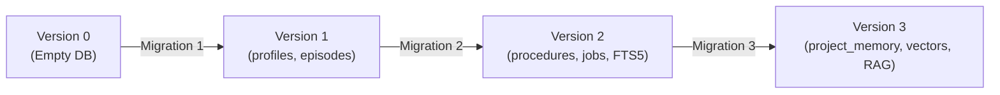

# BEL (Behavioral Executive Logic) — Memory Schema Specification
## SQLite Database Schema (Version 3)

This document provides the definitive schema specification for BEL's internal learning database (`brain.sqlite3`).

---

## 1. Database Configuration & Pragmas

BEL operates SQLite in high-reliability, fail-closed mode:
- `PRAGMA foreign_keys = ON;` — Guarantees cascading deletions and relational integrity.
- `PRAGMA secure_delete = ON;` — Overwrites deleted data with zeros to prevent forensic data remanence.
- `PRAGMA user_version = 3;` — Schema versioning indicator for atomic sequential migrations.
- `PRAGMA journal_mode = WAL;` — Write-Ahead Logging for high-concurrency read/write transactions.

---

## 2. Table Definitions

### 2.1 Project Memory Table (`project_memory`) — *Stage 3 Addition*
Stores structured knowledge strictly partitioned by project space.

```sql
CREATE TABLE project_memory (
    id TEXT PRIMARY KEY,
    project_id TEXT NOT NULL,
    category TEXT NOT NULL,
    title TEXT NOT NULL,
    content TEXT NOT NULL,
    importance INTEGER NOT NULL DEFAULT 3,
    confidence REAL NOT NULL DEFAULT 1.0,
    created_at REAL NOT NULL,
    updated_at REAL NOT NULL,
    expiry REAL,
    metadata TEXT NOT NULL DEFAULT '{}'
);

CREATE INDEX idx_project_memory_proj_cat ON project_memory(project_id, category);
```

| Column | Type | Description |
| :--- | :--- | :--- |
| `id` | `TEXT` | Unique UUID primary key. |
| `project_id` | `TEXT` | Project partition identifier (e.g. `BEL`, `ADA`, `Badami`, `Octo6`). |
| `category` | `TEXT` | Category: `goal`, `decision`, `architecture`, `choice`, `progress`, `issue`, `dependency`, `roadmap`, `file`. |
| `title` | `TEXT` | Short human-readable summary. |
| `content` | `TEXT` | Detailed knowledge body. |
| `importance`| `INTEGER` | Priority rating from 1 (lowest) to 5 (critical invariant). |
| `confidence`| `REAL` | Provenance confidence score ($0.0 \le c \le 1.0$). |
| `created_at`| `REAL` | Unix epoch creation timestamp. |
| `updated_at`| `REAL` | Unix epoch last modification timestamp. |
| `expiry` | `REAL` | Optional TTL expiration timestamp (NULL = permanent). |
| `metadata` | `TEXT` | JSON payload containing custom metadata attributes. |

---

### 2.2 Dense Memory Vectors Table (`memory_vectors`) — *Stage 3 Addition*
Stores compact binary float32 dense vector embeddings for hybrid semantic search.

```sql
CREATE TABLE memory_vectors (
    id TEXT PRIMARY KEY,
    store TEXT NOT NULL,
    project_id TEXT NOT NULL,
    dimension INTEGER NOT NULL,
    vector BLOB NOT NULL,
    updated_at REAL NOT NULL
);

CREATE INDEX idx_memory_vectors_store ON memory_vectors(store, project_id);
```

| Column | Type | Description |
| :--- | :--- | :--- |
| `id` | `TEXT` | Primary key referencing the memory record ID or chunk ID. |
| `store` | `TEXT` | Store identifier: `profile`, `episode`, `project`, `rag`. |
| `project_id` | `TEXT` | Project partition identifier. |
| `dimension` | `INTEGER`| Dimensionality of vector (default `128`). |
| `vector` | `BLOB` | 512-byte IEEE 754 packed float32 binary array (`128 * 4 bytes`). |
| `updated_at`| `REAL` | Unix epoch update timestamp. |

---

### 2.3 RAG Documents Catalog (`rag_documents`) — *Stage 3 Addition*
Tracks registered document containers in the RAG corpus.

```sql
CREATE TABLE rag_documents (
    id TEXT PRIMARY KEY,
    project_id TEXT NOT NULL,
    title TEXT NOT NULL,
    file_path TEXT,
    mime_type TEXT NOT NULL,
    content_hash TEXT NOT NULL,
    total_chunks INTEGER NOT NULL DEFAULT 0,
    metadata TEXT NOT NULL DEFAULT '{}',
    created_at REAL NOT NULL,
    updated_at REAL NOT NULL
);

CREATE INDEX idx_rag_docs_proj ON rag_documents(project_id);
```

---

### 2.4 RAG Document Chunks (`rag_chunks`) — *Stage 3 Addition*
Stores individual text chunks extracted from registered documents.

```sql
CREATE TABLE rag_chunks (
    id TEXT PRIMARY KEY,
    doc_id TEXT NOT NULL REFERENCES rag_documents(id) ON DELETE CASCADE,
    project_id TEXT NOT NULL,
    chunk_index INTEGER NOT NULL,
    content TEXT NOT NULL,
    token_count INTEGER NOT NULL,
    metadata TEXT NOT NULL DEFAULT '{}',
    created_at REAL NOT NULL,
    UNIQUE(doc_id, chunk_index)
);

CREATE INDEX idx_rag_chunks_doc ON rag_chunks(doc_id);
CREATE INDEX idx_rag_chunks_proj ON rag_chunks(project_id);
```

---

### 2.5 RAG Full-Text Search Index (`rag_fts`) — *Stage 3 Addition*
SQLite FTS5 virtual table indexing chunk content for sub-millisecond keyword matching.

```sql
CREATE VIRTUAL TABLE rag_fts USING fts5 (
    id UNINDEXED,
    doc_id UNINDEXED,
    project_id UNINDEXED,
    content
);
```

---

### 2.6 Established Core Tables (Version 1 & 2 Preservation)

- `profiles`: Verified personal user facts and preferences (`(owner_id, project_id, key)` unique).
- `episodes`: Chronological execution memories and interaction records.
- `memory_fts`: FTS5 index for profiles and episodes.
- `graph_edges`: Relational lineage tracking (`summarized_into`, `derived_from`).
- `procedures`: Immutable versioned learned skills with manifests, digests, and tests.
- `candidates`: Proposed skill drafts awaiting test execution and review.
- `jobs`: Background tasks and execution plans with idempotency keys.
- `steps`: Step lifecycle tracking for jobs.
- `receipts`: Content-addressed execution receipts.
- `brain_events`: Cryptographic audit trail log.
- `brain_settings`: System configuration key-value store.
- `reviews`: Retrospective lesson logs.

---

## 3. Migration Pipeline



When an existing database at Version 2 initializes under the new build:
1. `PRAGMA user_version` is read (returns 2).
2. Migration transaction executes `CREATE TABLE project_memory`, `CREATE TABLE memory_vectors`, `CREATE TABLE rag_documents`, `CREATE TABLE rag_chunks`, `CREATE VIRTUAL TABLE rag_fts`.
3. `PRAGMA user_version = 3;` is committed atomically.
4. If any step fails, the entire transaction is rolled back, preserving existing data without loss.
