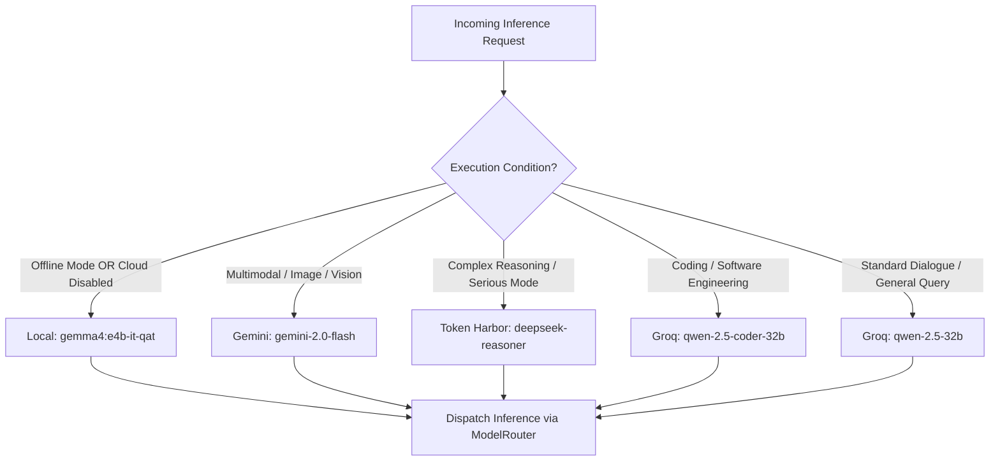

# BEL Intelligent Model Routing Architecture
**Specification Document — Stage 2**  
**Core Domain:** Task-Aware Model Routing, Provider Quotas, and Provider Policies  

---

## 1. Provider Portfolio & Configuration

BEL routes inference through a multi-tier model portfolio designed for task-specific performance, hardware safety, cost efficiency, and offline resilience.

| Provider ID | Target Models | Specialization / Role | Cost Tier | Default Fallback Order |
| :--- | :--- | :--- | :---: | :---: |
| **Local (Ollama)** | `gemma4:e4b-it-qat`, `llama3.2:1b-instruct-q4_K_M` | Zero-latency offline interaction, local invariant verification, private workspace commands. | Free (Local GPU/RAM) | Tier 1 (Always attempted first) |
| **Groq** | `qwen-2.5-32b`, `qwen-2.5-coder-32b` | High-speed general conversation and software engineering tasks. | Low / Free Tier | Tier 2 |
| **Token Harbor** | `deepseek-ai/DeepSeek-R1`, `deepseek-ai/DeepSeek-V3` | Deep mathematical reasoning, complex logic decomposition, and Serious Mode deliberation. | Moderate | Tier 3 (Complex tasks) |
| **Gemini** | `gemini-2.0-flash`, `gemini-2.0-flash-thinking-exp` | Multimodal screen observation, vision landmark analysis, and speech processing. | Variable | Tier 4 (Multimodal tasks) |
| **OpenRouter** | `meta-llama/llama-3.2-3b-instruct:free` | Redundant cloud fallback with strict zero-cost enforcement (`:free` suffix). | Free Tier | Tier 5 (Emergency fallback) |

---

## 2. Task-Aware Routing Matrix

The `DecisionEngine.select_route()` evaluates the parsed task characteristics and maps requests directly to the optimal model target:

---

## 3. Quota & Safety Controls

1. **Conservative Cost Estimation:**
   - Pre-flight token reservation calculates worst-case spend based on UTF-8 byte length plus maximum completion allowance.
   - Rejects inference pre-flight if daily spend ceiling is exceeded (`daily_budget_usd`).
2. **Provider Health & Cooldown:**
   - 429 rate limit responses trigger adaptive cooldown based on `Retry-After` headers or standard exponential backoff.
   - Detects daily quota limits and holds subsequent requests without burning API calls.
3. **Hardware Memory Sentinel Integration:**
   - Before dispatching local Ollama inference, checks `system_monitor.check_memory_safety(min_ram_mb=300)`.
   - If available RAM < 300 MiB and no cloud provider is authorized, gracefully throttles local model calls to prevent host laptop freezes.
