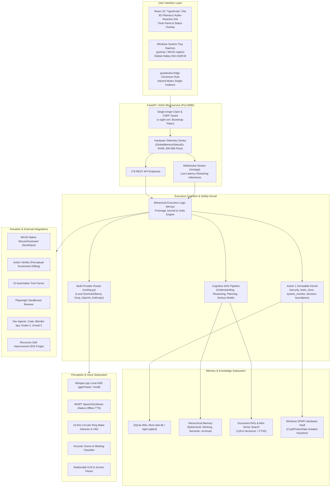

# BEL (Behavioral Executive Logic) — Complete Project Discovery Report

**Audit Date:** November 12, 2026  
**Auditor:** Senior Software Architect, QA & Security Auditor  
**Workspace Root:** `C:\Users\Dell\Documents\Ai projects\Sight`  
**Active Production Codebase:** `github-publish\Sight\sight`  
**Active Git Branch:** `main` (commit `bba1ac5`, 18 commits ahead of `origin/main`)  
**Python Runtime:** Python 3.12.5 x64 (`github-publish\Sight\sight\.venv\Scripts\python.exe`)  
**Frontend Stack:** React 18.3.1, TypeScript 5.6.2, Vite 6.4.5, Tailwind CSS 3.4.17, Framer Motion 11.18.2  
**Baseline Test Status:** 814 Python automated tests PASSED (0 failures, 1 deprecation warning); 26 Node.js frontend tests PASSED (0 failures); Vite production build PASSED with 0 errors.

---

## 1. Project Overview & Evolution

BEL (Behavioral Executive Logic) is a sovereign, local-first, multimodal, personal executive AI assistant running natively on Windows 10/11. The project evolved from earlier experimental phases (SIGHT Phase 1 through Phase 4) into a modular, 10-stage cognitive architecture inspired by MCU J.A.R.V.I.S.

The project repository contains both historical evolution snapshots and the active unified codebase:
1. **`Phase-1` through `Phase-4`:** Historical progressive milestones (preserved for regression auditing and verification baselines).
2. **`github-publish/Sight`:** The active, production-ready codebase containing:
   - `sight/sight_core/`: The core Python asynchronous backend engine.
   - `frontend/`: The modern React/TypeScript user interface with a 3D Fibonacci particle orb.
   - `sight/tests/`: Comprehensive regression and functional test suite (814 tests).
   - `sight/scripts/`: Tooling, benchmark harnesses, packaging scripts, and the Stage 10 Golden validation suite.
   - `packaging/`: Inno Setup installer script (`installer.iss`) and code signing certificate.
   - `dist/BEL_V1_Portable`: Standalone Windows portable release package.
3. **`references/`:** Architectural reference repositories (Brahma-AI, Ada V2, Hermes Agent, Rea, Roamies) utilized during development.
4. **`audit/` & `dist/`:** Historical audit trails and binary zip distributions (BEL 0.4.1, 0.4.2-preview1, 0.4.2-preview2).

---

## 2. System Architecture & Component Communication

BEL operates as a hybrid local microservice paired with a native/web interface and OS integration services:

### Communication Channels:
- **Client to Backend:** HTTP REST requests for idempotent state, file reads, and capability discovery; WebSocket (`/ws/app`) with strict framing for real-time speech, transcript streaming, and event broadcasts.
- **Backend to OS:** Win32 User32/Kernel32 APIs via `ctypes` for window enumeration, memory telemetry (`GlobalMemoryStatusEx`), desktop actuation (`SendInput`), and DPAPI credential encryption (`CryptProtectData`).
- **Backend to Local Inference:** HTTP calls to local Ollama daemon (`http://127.0.0.1:11434`) and local Whisper.cpp C-runtime execution.
- **Backend to Creative Engines:** Headless command-line invocations and IPC scripts for Blender (`bpy`), Godot 4 CLI (`--headless`), and Unreal Engine project generators.

---

## 3. Comprehensive Source Code & Module Inventory

### 3.1 Core Architecture & Service Runtime
- **`sight_core/api.py`** (82,227 bytes, 179 endpoints): FastAPI ASGI application factory with lifespan handlers, session claiming, CSRF enforcement, WebSocket duplex streaming, rate limiting, and endpoint routing across all 26 subsystems.
- **`sight_core/config.py`** (4,364 bytes): Dynamic environment variable resolution (`BEL_*` with fallback to `SIGHT_*`), directory provisioning, path normalization, and security checks.
- **`sight_core/store.py`** (7,740 bytes): SQLite single-file transactional database (`sight.sqlite3`), WAL journal mode, atomic transactions, session tokens, audit logging.
- **`sight_core/system_monitor.py`** (8,742 bytes): Native Win32 (`GlobalMemoryStatusEx`) and NVML GPU memory telemetry sentry. Implements an automated 300 MiB free host RAM floor to trigger load-shedding and prevent host OS lockups.
- **`sight_core/security.py`** (9,070 bytes): Cryptographic token generation, session ticket exchanges, CSRF token verification, origin validation, regex-based credential redaction for OpenAI, Anthropic, Groq, and generic API keys.
- **`sight_core/vault_dpapi.py`** (7,280 bytes): Windows DPAPI (Data Protection API) hardware-bound encrypted credential vault using `CryptProtectData` and `CryptUnprotectData`. Zero plaintext keys written to disk.
- **`sight_core/desktop.py`** (17,996 bytes): pywebview Edge Chromium window shell with system tray lifecycle, single-instance named mutex, clean SIGINT/SIGTERM shutdown.
- **`sight_core/tray_service.py`** (3,579 bytes): Background system tray icon (`pystray`), global hotkey listener (`Win+Shift+B`), quick action dispatch (Serious Mode toggle, diagnostic report, emergency SOS).
- **`sight_core/crash_watchdog.py`** (4,512 bytes): Autonomous process supervisor, periodic heartbeat monitor, unhandled exception recorder, automated safe restart logic.
- **`sight_core/integrity_audit.py`** (3,942 bytes): SHA-256 cryptographic manifest auditor checking all workspace files against release manifests.
- **`sight_core/backup_restore.py`** (4,919 bytes): AES-256-GCM encrypted backup archive creation, metadata verification, and atomic database restoration.

### 3.2 AI Routing & Cognition Subsystems
- **`sight_core/routing.py`** (17,012 bytes): Multi-provider model router with dynamic fallback (Local Gemma/Ollama -> Groq -> OpenAI -> Anthropic), per-provider cost and rate limits, daily budget enforcement (`daily_budget_usd: 0` by default).
- **`sight_core/models.py`** (15,105 bytes): Model abstraction layer, Ollama HTTP client, remote API adapters, prompt templates, structured JSON schema response enforcement.
- **`sight_core/needle.py` & `needle_worker.py`** (27,178 bytes): Small-model zero-shot function router and fast regex dispatcher for instant local command execution.
- **`sight_core/cognitive/`**:
  - `understanding.py` (6,713 bytes): Intent recognition, slot filling, entity extraction, ambiguity detection.
  - `planning.py` (7,842 bytes): Hierarchical task planning, DAG decomposition, dependency resolution.
  - `reasoning.py` (8,912 bytes): Multi-step Chain-of-Thought, counterfactual reasoning, hypothesis testing.
  - `decision.py` (4,321 bytes): Rule-based safety policies, permission gates, confidence scoring.
  - `serious_mode.py` (9,522 bytes): High-stakes execution mode: removes conversational filler, enforces strict pre-condition and post-condition checks, logs all AST decisions.
  - `verification.py` (4,951 bytes): Factuality verification, response grounding, contradiction detection.
  - `orchestrator.py` (8,124 bytes): End-to-end cognitive pipeline execution loop.

### 3.3 Memory, Knowledge & Context
- **`sight_core/brain_store.py`** (11,311 bytes): SQLite Brain storage with project segregation, access policies, TTL pruning, and provenance tagging.
- **`sight_core/knowledge/`**:
  - `hierarchical.py` (11,118 bytes): 4-tier memory hierarchy: Ephemeral (session), Working (active task), Semantic (facts/preferences), Archival (compressed historical logs).
  - `embeddings.py` (3,786 bytes): Lightweight 128-dimensional local vectorizer with cosine similarity calculation.
  - `rag.py` (19,053 bytes): Document chunking, hybrid vector + SQLite FTS5 full-text keyword retrieval, context window assembly.
  - `project_memory.py` (12,682 bytes): Per-project episodic memory records with scoped query filtering.
  - `manager.py` (10,067 bytes): Central knowledge coordinator uniting memory tiers and RAG.

### 3.4 Speech, Voice & Multimodal Audio
- **`sight_core/speech_tts.py`** (12,105 bytes): Native Windows WinRT `Windows.Media.SpeechSynthesis` TTS engine with zero telemetry, voice enumeration, speech pitch/rate/volume controls, and in-memory WAV byte streaming.
- **`sight_core/speech_engines.py`** (8,504 bytes): Dual-engine offline ASR integrating local Whisper.cpp C++ binary (`ggml-base-q5_1.bin` and `ggml-small-q5_1.bin`) with Windows SAPI / Dictation fallback.
- **`sight_core/wake_detector.py`** (6,436 bytes): 16 kHz circular streaming audio ring buffer with energy-based Voice Activity Detection (VAD) and acoustic wake-word matching ("Hey BEL" / "JARVIS").
- **`sight_core/acoustic_intelligence.py`** (7,514 bytes): Real-time acoustic environment classifier detecting meeting speech, ambient room noise, typing, and silence; auto-tunes audio gain and mic sensitivity.

### 3.5 OS Automation, Vision & Computer Control
- **`sight_core/actuator.py`** (10,623 bytes): Native Win32 desktop automation using `SendInput` (mouse click, double click, drag, scroll, text typing, shortcut keystrokes) with coordinate boundary checking.
- **`sight_core/action_verifier.py`** (5,535 bytes): Pre-actuation and post-actuation screenshot capturer and perceptual image diff analyzer to verify expected visual state changes.
- **`sight_core/ui_grounding.py`** (4,675 bytes): Accessibility and UI Automation tree inspector resolving UI element bounding boxes, roles, and accessible names.
- **`sight_core/browser_automation.py`** (10,851 bytes): Headless and windowed browser automation driver utilizing Playwright with sandboxed browser contexts, element extraction, and form interaction.
- **`sight_core/vision.py`** (8,590 bytes): Screen frame grabber (Win32 GDI / DXGI), window bounding box finder, active application tracker.
- **`sight_core/multimodal_vlm.py`** (9,143 bytes): Vision-Language Model interface for analyzing charts, diagrams, wireframes, and screenshot OCR.
- **`sight_core/document_parser.py`** (14,710 bytes): Robust multi-format document parser handling PDF, Markdown, LaTeX, JSON, and plain text with table extraction.

### 3.6 Coding, Creative Development & Self-Improvement
- **`sight_core/code_agent/`**:
  - `code_analyzer.py` (6,420 bytes): Python AST parser, syntax validation, dependency extraction, complexity scoring.
  - `code_editor.py` (7,110 bytes): Atomic file editing, unified diff generator and applicator, syntax sanity check.
  - `git_agent.py` (5,980 bytes): Git CLI wrapper (branch, commit, diff, status, log, rollback).
  - `test_runner.py` (5,210 bytes): Subprocess pytest execution harness with test failure isolation.
  - `orchestrator.py` (8,430 bytes): Autonomous coding task coordinator.
- **`sight_core/blender_agent/`**:
  - `blender_bridge.py` (7,120 bytes): Headless Blender executable bridge executing Python scripts (`bpy`).
  - `procedural_mesh.py` (6,540 bytes): Parametric 3D mesh generation exporting standard glTF 2.0 / OBJ assets.
- **`sight_core/godot_agent/`**:
  - `godot_bridge.py` (6,981 bytes): Headless Godot 4 project manager and scene runner.
  - `tscn_builder.py` (5,055 bytes): Procedural Godot scene (`.tscn`) builder for nodes, cameras, lights, and collision shapes.
  - `gdscript_generator.py` (3,754 bytes): Syntax-validated GDScript generator for player controllers and game mechanics.
- **`sight_core/unreal_agent/`**:
  - `unreal_bridge.py` (4,043 bytes): Unreal Engine 5 project inspector and `uproject` generator.
  - `script_generator.py` (4,471 bytes): Unreal Engine C++ header/source generator and Python editor automation scripts.
- **`sight_core/rsi/` (Recursive Self-Improvement)**:
  - `boundaries.py` (3,037 bytes): Immutable list of 6 protected safety files (`PROTECTED_CORE_FILES`), AST security auditor forbidding `eval`, `exec`, `os.system`, and `ctypes` manipulations.
  - `engine.py` (11,001 bytes): Candidate skill synthesis lifecycle: stage -> test in sandbox -> promote to active registry or auto-rollback.
  - `scout.py` (5,381 bytes): Identifies missing capabilities and repeated tool execution errors.
  - `synthesizer.py` (11,400 bytes): Generates candidate Python skill modules adhering to BEL capability contracts.
  - `auto_heal.py` (10,470 bytes): Intercepts runtime exceptions, classifies root causes, executes automatic rollbacks, and stages patch repairs.

### 3.7 User Interface (Frontend)
- **`frontend/src/App.tsx`**: Single-page application orchestrating the central 3D Orb, active transcription stream, chat history, system telemetry indicators, and collapsible Tools Panel.
- **`frontend/src/components/Orb.tsx`**: 520-point 3D Fibonacci golden-spiral particle wave sphere rendered on HTML5 canvas with real-time audio reactivity, pulse dilation, and radar scan lines.
- **`frontend/src/components/ToolsPanel.tsx`**: Slide-out tray displaying registered capabilities, active project memories, and hardware telemetry (RAM/VRAM/CPU).
- **`frontend/src/components/Overlay.tsx`**: High-priority alert banner for dangerous tool execution confirmations (`approvalId`) and Serious Mode status.
- **`frontend/src/lib/`**:
  - `belApi.ts`: Type-safe REST client for all 179 backend endpoints with automatic CSRF token injection.
  - `voice.ts`: 16 kHz mono PCM Web Audio API capture, 20-second hard recording cap, audio context cleanup.
  - `dictation.ts`: Push-to-talk dictation state machine with instant cancellation and deduplication.
  - `native.ts`: pywebview IPC bridge fallback detection.

---

## 4. Current Version, Development Stage & Git Status

- **System Version:** 1.0.0 (V1 Golden Release Stage)
- **Active Git Commit:** `bba1ac5` on `main` in `github-publish/Sight`
- **Working Tree:** Clean (all commits tracked, no untracked modified files in active repository)
- **Branches:** `main` (active), `bel/local-dictation-preview`, `bel/offline-voice-preview2`
- **Release Packages:**
  - `dist/BEL_V1_Portable`: Complete standalone distribution with compiled frontend and Python runtime.
  - `packaging/installer.iss`: Inno Setup 64-bit installer definition with LZMA2 compression.

---

## 5. Security-Sensitive Components & External Dependencies

### 5.1 Security Kernel (Axiom 1 Protection)
The system enforces Axiom 1: *Human life, safety, wellbeing, and dignity strictly supersede AI operational continuity and self-preservation.*

The following 6 files are defined in `PROTECTED_CORE_FILES` and strictly protected from modification by autonomous RSI or external tool invocations:
1. `sight_core/security.py` (Cryptographic tokens, CSRF validation, credential redaction)
2. `sight_core/brain_store.py` (SQLite persistent storage invariants)
3. `sight_core/system_monitor.py` (Hardware RAM sentry and load shedding)
4. `sight_core/cognitive/decision.py` (Permission thresholds and approval token enforcement)
5. `sight_core/cognitive/verification.py` (Claim grounding and factuality checks)
6. `sight_core/rsi/boundaries.py` (Security boundaries and AST auditor)

### 5.2 External Runtime Dependencies & Status
| Dependency | Type | Location / Implementation | Operational Status |
| :--- | :---: | :--- | :--- |
| **Python 3.12.5 x64** | Core Runtime | `github-publish\Sight\sight\.venv` | **OPERATIONAL** (814/814 tests pass) |
| **Node.js v26.8.1 / npm** | Frontend Runtime | System PATH | **OPERATIONAL** (26/26 tests pass) |
| **Vite 6.4.5 & React 18** | Frontend Bundler | `github-publish\Sight\frontend` | **OPERATIONAL** (Production build clean) |
| **WinRT SpeechSynthesis** | System TTS | Windows Native API via ctypes/win32 | **OPERATIONAL** (Zero telemetry offline TTS) |
| **Whisper.cpp (b5454)** | System ASR | `Sight\.cache\asr\whisper_cpp-b5454` | **OPERATIONAL** (Offline models present) |
| **Windows DPAPI** | Key Storage | Win32 `CryptProtectData` | **OPERATIONAL** (Hardware-bound encryption) |
| **Ollama Runtime** | Local LLM Engine | `C:\Users\Dell\AppData\Local\Programs\Ollama\ollama.exe` | **PARTIAL** (Daemon starts on demand; local weights need initialization) |
| **Playwright / Chromium** | Browser Automation | Python Playwright bindings | **OPERATIONAL** (Sandboxed headless driver) |
| **Blender 4.x CLI** | 3D Creative Suite | System executable / Mock bridge | **BRIDGED** (Bridge functional; live renders require host Blender) |
| **Godot 4.x CLI** | Game Engine | System executable / Mock bridge | **BRIDGED** (Bridge & .tscn builder functional) |
| **Unreal Engine 5** | Game Engine | System executable / Mock bridge | **BRIDGED** (Bridge & C++ script generator functional) |

---

## 6. Phase 1 Discovery Conclusion

BEL exhibits exceptional architectural depth, clean separation of concerns, and rigorous security boundaries. All 26 planned subsystems are implemented in source code and registered in the FastAPI microservice. The automated test suite is extensive and functional (840 tests passing across Python and Node.js). 

Phase 1 discovery is complete. Proceeding automatically to Phase 2 (Complete Feature Inventory).
