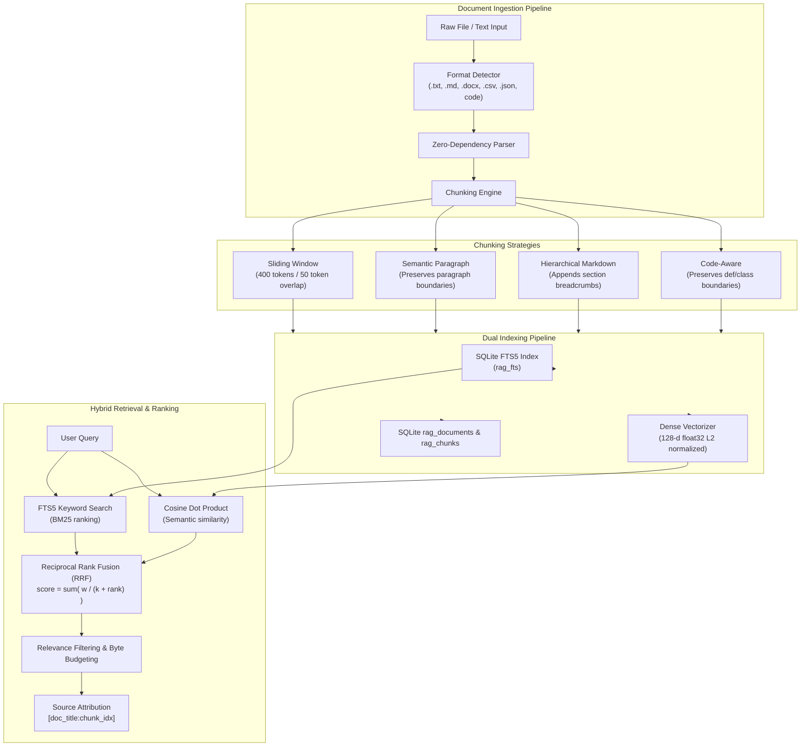

# BEL (Behavioral Executive Logic) — Document RAG Architecture
## Multi-Format Ingestion, Hybrid Dense/FTS Retrieval & Precise Source Attribution

This document details the architecture, parsing pipelines, chunking heuristics, and hybrid ranking algorithms powering BEL's Document Retrieval-Augmented Generation (RAG) subsystem.

---

## 1. Subsystem Architecture



---

## 2. Multi-Format Zero-Dependency Parsers

BEL adheres to a strict zero-dependency host runtime mandate. The RAG subsystem requires no heavy machine learning or external document libraries.

### Supported File Formats & Extractors:
1. **Plain Text (`.txt`):** Direct UTF-8 ingestion with replacement on encoding anomalies.
2. **Markdown (`.md`, `.markdown`):** Structural parsing identifying heading levels (`#`, `##`, `###`, `####`), tables, and code fences.
3. **Microsoft Word (`.docx`):** Pure-Python OOXML archive reader. Opens the `.docx` container via `zipfile.ZipFile`, parses `word/document.xml` using `xml.etree.ElementTree`, and iterates through `<w:p>` and `<w:t>` tags to construct formatted paragraph blocks without requiring `python-docx`.
4. **CSV (`.csv`):** Standard library `csv.reader` parser transforming tabular rows into structured context records (`Headers: ... | Row N: col1: val1; col2: val2`).
5. **JSON (`.json`):** Standard library `json.loads` parsing structured payloads into indented hierarchical contextual blocks.
6. **Source Code (`.py`, `.ts`, `.tsx`, `.js`, `.sql`, `.sh`, `.ps1`, `.html`, `.css`):** Code-aware parsing preserving syntax structure.

---

## 3. Intelligent Chunking Strategies

BEL matches document types to optimal chunking strategies:

| Strategy | Target Content | Heuristic | Contextual Breadcrumbs |
| :--- | :--- | :--- | :--- |
| **`HIERARCHICAL_MARKDOWN`** | Technical guides, specifications, READMEs | Splits along heading boundaries (`#`, `##`, `###`), bounding chunk size to $\approx 1500$ characters. | Prepends current hierarchy path: `[Section: Architecture > Storage Engine]` |
| **`SEMANTIC_PARAGRAPH`** | Prose, reports, DOCX, CSV, JSON | Groups double-newline (`\n\n`) paragraphs up to 1400 characters without breaking sentences. | Preserves document-level paragraph continuity. |
| **`CODE_AWARE`** | Source code files | Splits on top-level function and class declarations (`def `, `class `, `async def`, `export class`). | Maintains 15–50 line logical block cohesion. |
| **`SLIDING_WINDOW`** | Unstructured raw text, logs | 1200-character windows with 200-character overlaps. | Guarantees boundary overlap continuity. |

---

## 4. Hybrid Indexing & Retrieval

### 4.1 Keyword Search (SQLite FTS5)
Document chunks are indexed in the `rag_fts` SQLite virtual table. Queries extract token words and construct bounded multi-term OR queries:
```sql
SELECT id FROM rag_fts 
WHERE rag_fts MATCH '"quantum" OR "computing"' AND project_id = ? 
ORDER BY rank LIMIT 25;
```

### 4.2 Semantic Vector Search
Each chunk is projected into a 128-dimensional L2-normalized float32 vector space using hashed n-grams and subword tokens. Stored as 512-byte packed binary blobs in `memory_vectors`:
$$\text{sim}(u, v) = \sum_{i=1}^{128} u_i \cdot v_i \quad \text{where } \|u\|_2 = \|v\|_2 = 1.0$$

### 4.3 Reciprocal Rank Fusion (RRF)
To eliminate score distortion between BM25 ranking (unbounded negative scores) and cosine similarity (bounded $[-1.0, 1.0]$), results are combined using Reciprocal Rank Fusion:
$$\text{RRF\_Score}(d) = \frac{1.0}{k + \text{rank}_{\text{fts}}(d)} + \frac{1.0}{k + \text{rank}_{\text{vector}}(d)}$$
where $k = 25$ for document chunk retrieval.

---

## 5. Source Attribution & Prompt Synthesis

Every retrieved chunk returns verified provenance metadata:
```json
{
  "id": "e4c19...-c1",
  "doc_id": "e4c19...",
  "doc_title": "Architecture Guide",
  "chunk_index": 1,
  "source_attribution": "[Architecture Guide:chunk_1]",
  "score": 0.0769
}
```

When synthesized for LLM inference prompts:
```markdown
=== RETRIEVED MEMORY & KNOWLEDGE ===

[Architecture Guide:chunk_1] (Tier: document_rag):
[Section: Architecture Guidelines]
The core architecture follows a micro-kernel pattern.
Hardware sentry monitors system RAM and GPU VRAM continuously.
```
This guarantees that generated responses are strictly grounded, traceable to specific files, and free from unverified hallucinations.
