# BEL Cognitive & Reasoning Architecture
**Specification Document — Stage 2**  
**Core Domain:** Behavioral Executive Logic (BEL) Cognitive Engine  

---

## 1. Architectural Overview

BEL's cognitive architecture provides autonomous decision making, multi-step problem solving, and contextual continuity while enforcing **fail-closed permission boundaries**. The AI model does not hold direct execution handles; all actions flow through structured reasoning, plan formulation, risk evaluation, and human authorization.

```mermaid
classDiagram
    class CognitiveOrchestrator {
        +InputUnderstanding understanding
        +ContextManager context
        +ReasoningEngine reasoning
        +PlanningEngine planning
        +DecisionEngine decision
        +ResponseEngine response
        +SeriousModeEngine serious_mode
        +VerificationEngine verification
        +process_turn(user_text, request_id, is_offline) dict
    }

    class InputUnderstanding {
        +parse(text, context_entities) ParsedInput
        -_detect_ambiguity(text, intent, entities) tuple
    }

    class ContextManager {
        +list turns
        +dict active_entities
        +dict ongoing_tasks
        +add_turn(role, text, intent, entities) TurnRecord
        +resolve_references(text) dict
        +track_task(task_id, goal, total_steps) TaskState
        +update_task(task_id, status, step_index) TaskState
    }

    class ReasoningEngine {
        +reason_about_task(goal, sub_instructions, entities) ReasoningTrace
        -_identify_approaches(text) list
        -_estimate_risk(text) str
    }

    class PlanningEngine {
        +create_plan(trace, entities) Plan
        +get_ready_steps(plan) list~PlanStep~
        +mark_step(plan, step_id, status, result) void
        +replan_on_failure(plan, failed_step_id, error) Plan
    }

    class DecisionEngine {
        +evaluate_permission(tool_name, arguments) ActionPermission
        +select_route(task_category, is_offline, allow_cloud) ModelRoute
    }

    class SeriousModeEngine {
        +deliberate(task, custom_consultants) DeliberationResult
        -_detect_contradictions(consultations) list~Contradiction~
        -_evaluate_evidence(consultations, contradictions) str
    }

    class VerificationEngine {
        +verify_tool_outcome(tool_name, arguments, result) VerificationResult
        +validate_model_response(text) tuple
    }

    class ResponseEngine {
        +format_plan_proposal(goal, count, summaries) str
        +format_tool_result(tool_name, result) str
        +format_failure(operation, reason, hint) str
        +format_clarification_prompt(question) str
    }

    CognitiveOrchestrator --> InputUnderstanding
    CognitiveOrchestrator --> ContextManager
    CognitiveOrchestrator --> ReasoningEngine
    CognitiveOrchestrator --> PlanningEngine
    CognitiveOrchestrator --> DecisionEngine
    CognitiveOrchestrator --> ResponseEngine
    CognitiveOrchestrator --> SeriousModeEngine
    CognitiveOrchestrator --> VerificationEngine
```

---

## 2. Component Specifications

### 2.1 Input Understanding (`understanding.py`)
- **Intent Types:**
  - `CONVERSATION`: Standard user question, dialogue, or query.
  - `TOOL_ACTION`: Single targeted operation (e.g., launch app, search workspace).
  - `TASK_PLAN`: Multi-step compound instruction.
  - `SERIOUS_MODE`: High-stakes inquiry requiring multi-model cross-examination.
  - `SYSTEM_QUERY`: Diagnostic query (telemetry, hardware status, help).
  - `CORRECTION`: User correction of prior assertion ("No, I meant...").
- **Entity Identification:** Detects filenames (`*.txt`, `*.md`, `*.py`, `*.docx`), applications (`notepad`, `calculator`), and targets.
- **Ambiguity Detection:** Verifies that required arguments are present before issuing an action proposal. If missing, requests clarification.

### 2.2 Context Manager (`context.py`)
- **Anaphoric Resolution:** Resolves "that file", "the app", "it", or "the previous output" by inspecting `active_entities` recorded in prior conversation turns.
- **Task Tracking:** Maintains ongoing task states (`pending`, `running`, `completed`, `failed`) and coordinates multi-step execution.
- **Turn Truncation:** Maintains a rolling window of recent conversational turns.

### 2.3 Reasoning & Problem Decomposition (`reasoning.py`)
- **Decomposition:** Splits compound goals into an acyclic dependency graph of sub-problems.
- **Trade-off Analysis:** Compares local execution vs remote synthesis.
- **Uncertainty Quantification:** Flags unresolved assumptions and estimates operational risks (`low`, `medium`, `high`).

### 2.4 Planning Engine (`planning.py`)
- **Actionable Steps:** Formulates `PlanStep` items equipped with exact tool names and arguments.
- **Topological Readiness:** `get_ready_steps()` dynamically returns steps whose dependencies have succeeded.
- **Dynamic Replanning:** When an execution step fails, `replan_on_failure()` safely cancels downstream dependent steps and explains the root cause.

### 2.5 Decision Engine (`decision.py`)
- **Permission Tiers:**
  - `READ_ONLY`: Automated execution allowed (workspace queries, telemetry).
  - `REVERSIBLE`: Single-use human authorization required; pre-image recorded in SQLite journal before execution.
  - `CONSEQUENTIAL`: System app launches; requires explicit user grant.
  - `DESTRUCTIVE`: History clear, file deletions; requires explicit user grant.
- **Task-Aware Routing:** Selects optimal model provider and parameter profile matching task demands.

### 2.6 Serious Mode Engine (`serious_mode.py`)
- **Multi-Perspective Consultation:** Queries three distinct perspectives:
  1. *Deductive Reasoning:* Analyzes first principles, invariants, and edge cases.
  2. *Adversarial Critique:* Challenges assumptions and tests failure modes.
  3. *Practical Execution:* Evaluates feasibility, performance, and host constraints.
- **Contradiction Detection:** Extracts core assertions from each model and detects opposing feasibility or safety recommendations.
- **Truth Over Consensus:** Reconciles differences using physical constraints and fail-closed safety criteria rather than simple democratic voting.

### 2.7 Verification Engine (`verification.py`)
- **Proof-Based Validation:** Validates SHA256 hashes for created/edited files, confirmed OS window HWND/PIDs for applications, and journal match for undos.
- **Classification:** Distinguishes recoverable transient failures (retryable) from deterministic prerequisite errors.
