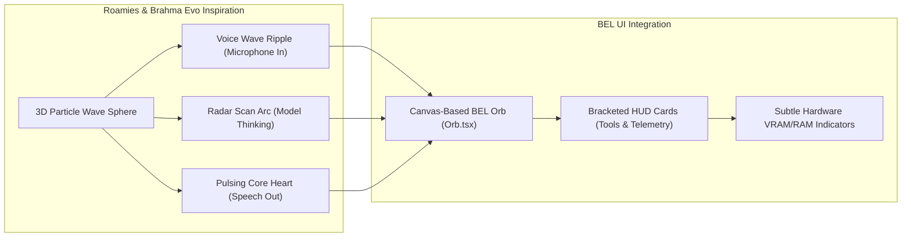

# BEL — REFERENCES DIRECTORY ANALYSIS & INSPIRATION REPORT
**Document Version:** 1.0.0-INSPIRATION  
**Date:** 10 November 2026  
**Auditor & Lead Systems Engineer:** Google Antigravity AI  
**Scope:** Exhaustive inspection of all 10 reference projects in `references/`  
**Purpose:** Extract, evaluate, and map architectural, UI/UX, and functional inspirations into BEL  

---

## Executive Summary

The `references/` directory contains an extraordinary collection of ten advanced AI, agentic, desktop, and reverse-engineering codebases spanning over 100,000 source files. These materials represent distinct architectural philosophies:
1. **Self-Improving Autonomous Agent Loops:** *Hermes Agent* (Nous Research), *Ada-SI* (Scout + Forge Master), and *Brahma AI Evo* (Project Ultron).
2. **Local-First Windows Assistants & Hardware HUDs:** *A.D.A Pocket AI*, *Brahma Echo*, *Brahma-AI---Lite*, and *Brahma-AI*.
3. **Multimodal Engineering & Parametric CAD:** *A.D.A V2* (Gemini Native Audio + `build123d` CAD + 3D printing).
4. **Authentic MCU J.A.R.V.I.S. Visuals & Lightweight Hosts:** *Roamies* (golden-spiral 3D rippling particle wave sphere in `jarvis.js`, Tauri/Rust desktop overlay).
5. **Deep Application Diagnostics & System Inspection:** *REA* (Reverse Engineer Anything MCP suite).

None of these projects should be imported wholesale — doing so would introduce licensing conflicts, unvetted dependencies, and security vulnerabilities. However, they provide **immense architectural clarity** and **battle-tested patterns** that directly accelerate BEL's 14-stage master roadmap.

---

## A. Reference Inventory

| # | Reference Project | Primary Technologies | Core Domain / Category | Location in Workspace | License & Rights |
|---|---|---|---|---|---|
| **1** | **Ada-SI** | Python, LiteLLM, FastAPI, Docker | Local self-improving assistant; Forge tool synthesis | `references/repos/Ada-SI-main/`<br>`references/archives/Ada-SI-main.zip` | MIT (Nazir Louis) |
| **2** | **A.D.A Pocket AI** | Python 3.10+, PySide6, Ollama, PyNVML | Local Windows 11 voice assistant; system monitoring | `references/repos/ada_local-main/`<br>`references/archives/ada_local-main.zip` | Open source / Personal |
| **3** | **A.D.A V2** | Electron 28, React 18, Python, Gemini 2.5 Audio, `build123d` | Multimodal CAD generation, 3D printing, gesture control | `references/repos/ada_v2-main/`<br>`references/archives/ada_v2-main.zip` | MIT |
| **4** | **Brahma AI — Lite** | Python, Electron, Playwright, python-docx | Windows productivity assistant; document generation | `references/repos/Brahma-AI---Lite-main/`<br>`references/archives/Brahma-AI---Lite-main.zip` | Source available |
| **5** | **Brahma AI Evo** | Python, Electron, AST, Gemini API | Self-evolving JARVIS assistant; Auto-Heal; Circuit HUD | `references/repos/Brahma-Ai-Evo-main/`<br>`references/archives/Brahma-Ai-Evo-main.zip` | Source available |
| **6** | **Brahma AI** | Python, Electron, Playwright, Gemini API | Windows desktop assistant; web automation | `references/repos/Brahma-AI-main/`<br>`references/archives/Brahma-AI-main.zip` | Source available |
| **7** | **Brahma Echo** | Python, Electron, Discord gateway | Contextual screen assistant; multi-channel bridge | `references/repos/Brahma-Echo-main/`<br>`references/archives/Brahma-Echo-main.zip` | Source available |
| **8** | **Hermes Agent** | Python 3.11+, Textual TUI, SQLite FTS5, Honcho | Industrial-grade self-improving agent platform | `references/repos/hermes-agent-main/`<br>`references/archives/hermes-agent-main.zip` | MIT (Nous Research) |
| **9** | **REA (Reverse Engineer Anything)** | TypeScript / Node.js, MCP, Ghidra, pwntools | Reverse engineering & binary analysis MCP server | `references/archives/rea-main.zip` | Apache-2.0 / MIT |
| **10** | **Roamies** | Tauri (Rust), WebGL / Canvas, Web Audio | Desktop companion; MCU J.A.R.V.I.S. 3D wave sphere | `references/archives/Roamies-main.zip` | AGPL-3.0 (Ken Kai) |

---

## B. Individual Analysis of References

### 1. Ada-SI (`Ada-SI-main`)
- **What it is:** A local-first, self-extending AI assistant with a dual-agent architecture: **Scout** (conversational agent) and **Forge Master** (tool synthesizer).
- **Problem it solves:** Automates the expansion of agent capabilities by identifying capability gaps during conversations and writing new Python tools on the fly.
- **Strongest Engineering Decisions:**
  - Automated test generation: The Forge Master writes unit test cases alongside generated tools before they are registered.
  - Multi-agent separation: The conversational agent never writes code directly; tool creation is delegated to a specialized sub-agent.
- **Valuable for BEL:** The capability-gap detection pattern (recognizing when user intent exceeds registered tools) and test-case generation before promotion.
- **What NOT to adopt:** Arbitrary pip installations directly into the host Python virtual environment without container sandboxing. Unauthenticated open ports (8080/8090).
- **Integration Feasibility:** **Medium** (requires secure containerization).

### 2. A.D.A Pocket AI (`ada_local-main`)
- **What it is:** A fully local, privacy-centric Windows assistant with Windows 11 Fluent dark styling.
- **Problem it solves:** Delivers a complete desktop assistant (voice, calendar, smart home, weather) without cloud dependencies or telemetry.
- **Strongest Engineering Decisions:**
  - **Title-Bar Hardware Telemetry (`system_monitor.py`):** Real-time monitoring of CPU, RAM, and NVIDIA GPU VRAM (via `pynvml`), showing active Ollama model footprint.
  - Offline continuous wake-word listening loop using Vosk/openWakeWord.
- **Valuable for BEL:** The `pynvml` GPU VRAM and host RAM monitoring worker. Crucial for BEL to prevent OOM crashes on the Dell G15 RTX 4060 laptop.
- **What NOT to adopt:** PySide6 desktop GUI (BEL's React Framer Motion orb is visually superior).
- **Integration Feasibility:** **High** (the telemetry collector is clean, lightweight, and uses standard `psutil` + `pynvml`).

### 3. A.D.A V2 (`ada_v2-main`)
- **What it is:** An Advanced Design Assistant integrating multimodal voice, computer vision, 3D parametric CAD, and 3D printing.
- **Problem it solves:** Transforms natural language voice requests directly into physical 3D objects and slices them for manufacturing.
- **Strongest Engineering Decisions:**
  - **Parametric CAD Generation (`cad_agent.py`):** Uses the modern `build123d` Python library to generate precise solid geometry, centering parts and exporting clean STL files.
  - **Self-Healing CAD Compilation Loop:** If `build123d` raises a syntax or geometric error (e.g., fillet radius too large), the agent captures the traceback, feeds it back to the LLM, and retries up to 3 times.
  - **Printer Discovery & Slicing (`printer_agent.py`):** Uses Zeroconf mDNS to discover OctoPrint and Moonraker/Klipper printers, invokes headless OrcaSlicer CLI, and monitors print temperatures and progress.
- **Valuable for BEL:** Direct fulfillment of **BEL Stage 10 (Creative Development Modules — 3D Modeling & Printing)**.
- **What NOT to adopt:** Heavy Electron shell; CPU-intensive MediaPipe hand-tracking gestures.
- **Integration Feasibility:** **High** (clean Python backend agents with zero invasive host changes).

### 4. Brahma AI — Lite (`Brahma-AI---Lite-main`)
- **What it is:** An open-source Windows desktop assistant focused on executive productivity and document automation.
- **Problem it solves:** Automates generation of professional reports, presentations, and documents from voice commands.
- **Strongest Engineering Decisions:** Structured generators using `python-docx`, `python-pptx`, and `reportlab` with standardized templates.
- **Valuable for BEL:** Document and presentation creation tools for BEL's executive assistant persona.
- **What NOT to adopt:** Raw mouse-coordinate click automation without visual verification.
- **Integration Feasibility:** **High** (standard Python libraries with deterministic file outputs).

### 5. Brahma AI Evo (`Brahma-Ai-Evo-main`)
- **What it is:** A next-generation desktop intelligence built to function like an MCU J.A.R.V.I.S. command center.
- **Problem it solves:** Autonomous self-maintenance, dynamic skill synthesis, and interactive hardware circuit HUD visualization.
- **Strongest Engineering Decisions:**
  - **Proactive Auto-Heal Engine (`auto_heal_engine.py`):** Background sentry captures uncaught exceptions, parses tracebacks to isolate first-party code, synthesizes minimal surgical hotfixes, verifies syntax with `ast.parse` and `py_compile`, and applies patches with atomic backup and rollback guarantees.
  - **Immutable Core Protection (`PROTECTED_CORE_FILES`):** Explicit allowlist/denylist preventing the AI from modifying its own core safety files.
  - **Interactive Circuit HUD:** Dark glassmorphic popup overlay with pinout labels and animated neon SVG glowing wires with electron flow pulses for microcontroller wiring.
- **Valuable for BEL:** The Auto-Heal architecture for **BEL Stage 13 (Self-Maintenance & Reliability)** and the neon SVG UI aesthetic for hardware projects.
- **What NOT to adopt:** Dynamic live monkey-patching of running modules without controlled restart.
- **Integration Feasibility:** **Medium** (Auto-Heal requires careful permission gating).

### 6. Brahma AI (`Brahma-AI-main`)
- **What it is:** Foundation Windows assistant integrating Playwright browser workflows and local command execution.
- **Problem it solves:** Basic desktop task automation.
- **Strongest Engineering Decisions:** Straightforward Playwright browser agent integration.
- **Valuable for BEL:** Multi-turn browser action schemas.
- **What NOT to adopt:** Unsandboxed terminal execution.
- **Integration Feasibility:** **Medium**.

### 7. Brahma Echo (`Brahma-Echo-main`)
- **What it is:** Premium Windows assistant with contextual screen awareness and multi-channel remote bridge.
- **Problem it solves:** Interacting with a home PC assistant remotely from mobile devices or messaging platforms.
- **Strongest Engineering Decisions:**
  - Multi-channel gateway allowing secure remote task dispatch via Discord.
  - Contextual screen inspection: periodic low-resolution desktop snapshots used to provide contextual awareness.
- **Valuable for BEL:** Remote companion bridge (accessing BEL securely while away from the laptop).
- **What NOT to adopt:** Unencrypted cloud relay bots.
- **Integration Feasibility:** **Medium**.

### 8. Hermes Agent (`hermes-agent-main`)
- **What it is:** Nous Research’s flagship open-source autonomous agent platform with a closed self-improving learning loop.
- **Problem it solves:** Provides production-grade memory persistence, background skill curation, subagent delegation, and cross-session learning.
- **Strongest Engineering Decisions:**
  - **The Curator (`curator.py`):** Inactivity-triggered background maintenance daemon. Automatically inspects skill usage, archives obsolete tools, consolidates duplicate skills, and patches tools based on execution feedback. *Core Invariant:* Never delete, only archive (fully recoverable).
  - **Pre-Compression Memory Checkpoint (`on_pre_compress`):** Before LLM context windows truncate conversation history, triggers a checkpoint hook to persist critical facts to memory.
  - **Subagent Parallelism (`subagent_lifecycle.py`):** Spawns isolated worker subagents with independent context windows for parallel research and coding tasks, preventing main-session context bloat.
  - **Dialectic User Modeling:** Progressively builds a nuanced psychological and behavioral profile of the user over time.
- **Valuable for BEL:** The Curator and pre-compression memory checkpointing represent the gold standard for **BEL Stage 4 & 5 (Autonomous Planning & Advanced Memory)**.
- **What NOT to adopt:** Multi-tenant enterprise cloud complexity; TUI interface as the primary presentation tier.
- **Integration Feasibility:** **High** (modular, standalone Python modules with clear contracts).

### 9. REA: Reverse Engineer Anything (`rea-main.zip`)
- **What it is:** An enterprise Model Context Protocol (MCP) server for deep binary, application, and system analysis.
- **Problem it solves:** Equips an AI agent with the tools to reverse-engineer, inspect, and understand closed-source applications, binaries, and system state.
- **Strongest Engineering Decisions:**
  - **Windows PE & Process Diagnostics:** Inspects PE headers, imports, exports, and DLL dependencies of Windows executables.
  - **Structured MCP Contracts:** Strictly typed tool schemas with deterministic JSON error recovery and process isolation.
- **Valuable for BEL:** Crucial for **BEL Stage 6 (Coding Agent)** and **Stage 7 (Computer Control)**: enables BEL to inspect third-party Windows apps, diagnose crashed software, and analyze binary dependencies.
- **What NOT to adopt:** Offensive exploit generation tools (`pwntools` shellcode generators).
- **Integration Feasibility:** **Medium** (can be integrated as a local MCP server).

### 10. Roamies (`Roamies-main.zip`)
- **What it is:** A desktop companion application featuring an authentic MCU J.A.R.V.I.S. visual intelligence.
- **Problem it solves:** Provides a floating, persistent, animated assistant presence that lives directly on your Windows desktop.
- **Strongest Engineering Decisions:**
  - **MCU J.A.R.V.I.S. 3D Wave Sphere (`jarvis.js`):**
    - 520 mathematical points distributed across a 3D sphere via golden spiral.
    - Real-time voice audio wave bulging: audio volume ripples through the sphere points like sound waves.
    - True 3D perspective projection with yaw, pitch, roll, and Lambertian lighting.
    - Glowing central heart that swells during speech and dims when resting.
    - Radar-sweep thinking animation and HUD reticle cursor mode.
  - **Lightweight Tauri Architecture:** Built on Rust and Webview, consuming <30 MB RAM (vs. 200 MB+ for Electron).
- **Valuable for BEL:** **The definitive visual reference for BEL's animated orb!** The `jarvis.js` algorithm can be directly adapted into BEL's React Framer Motion Orb component.
- **What NOT to adopt:** Desktop pet animations (waving anime characters) that conflict with BEL's refined, professional MCU persona.
- **Integration Feasibility:** **High** (`jarvis.js` is pure, dependency-free mathematical rendering logic).

---

## C. The 10 Most Valuable Inspirations for BEL

```
┌────────────────────────────────────────────────────────────────────────────────────────┐
│                                 THE TOP 10 INSPIRATIONS                                │
├────┬─────────────────────────────┬───────────────────┬─────────────────────────────────┤
│ #  │ Inspiration                 │ Source Reference  │ Target BEL Capability           │
├────┼─────────────────────────────┼───────────────────┼─────────────────────────────────┤
│ 1  │ 3D Audio-Rippled Wave Sphere│ Roamies (jarvis)  │ Orb UI & Visual Identity        │
│ 2  │ Background Curator Engine   │ Hermes Agent      │ Memory & Skill Self-Maintenance │
│ 3  │ Pre-Compression Checkpoint  │ Hermes Agent      │ Zero-Loss Memory Retention      │
│ 4  │ Proactive Auto-Heal Sentry  │ Brahma AI Evo     │ Self-Healing & Diagnostics      │
│ 5  │ Parametric CAD via build123d│ ADA V2            │ Creative 3D Engineering Module  │
│ 6  │ Hardware Telemetry Worker   │ ADA Pocket AI     │ Host RAM & GPU VRAM Sentry      │
│ 7  │ Subagent Worktree Isolation │ Hermes Agent      │ Autonomous Coding Agent         │
│ 8  │ Slicing & 3D Printer Hub    │ ADA V2            │ 3D Printing & Physical Devices  │
│ 9  │ Windows PE & Process MCP    │ REA               │ System Inspection & Debugging   │
│ 10 │ Neon SVG Circuit HUD        │ Brahma AI Evo     │ Electronics & Hardware HUD      │
└────┴─────────────────────────────┴───────────────────┴─────────────────────────────────┘
```

---

## D. Deep Dive: Technical Opportunities for BEL

### 1. Visual & Audio Orb Evolution (`Roamies` → BEL Frontend)
- **Current BEL State:** CSS layered divs with Framer Motion glow and pulse animations.
- **The Opportunity:** Port the golden-spiral sphere projection from `Roamies/jarvis.js` into an HTML5 Canvas component inside [`Orb.tsx`](file:///c:/Users/Dell/Documents/Ai%20projects/Sight/github-publish/Sight/frontend/src/components/Orb.tsx).
- **User Experience Impact:** As the owner speaks, the orb's particle surface ripples in real-time with the microphone frequency bands. During Gemma thinking, an icy-blue radar sweep arcs across the sphere.

### 2. Autonomous Memory & Skill Curator (`Hermes` → `sight_core`)
- **Current BEL State:** Manual memory deletion and static declarative Forge skills.
- **The Opportunity:** Implement `Curator` in `sight_core/curator.py`. Runs only when BEL is idle for >2 hours. Automatically reviews recent tasks, identifies frequently reused workflows, stages consolidated skills, and archives unused tools into `owner-data/archive/`.
- **Safety Invariant:** The Curator **never deletes**, only archives with full recovery receipts.

### 3. Context Pre-Compression Memory Hook (`Hermes` → `sight_core/models.py`)
- **Current BEL State:** Requests exceeding 1,280 bytes are rejected with `context_limit`.
- **The Opportunity:** Before truncating or summarizing conversation context, BEL triggers `on_pre_compress()`. Key decisions, preferences, and facts mentioned in the conversation are automatically extracted and saved to `profiles` and `episodes` in `brain.db`.

### 4. Parametric CAD & 3D Printing (`ADA V2` → BEL Creative Module)
- **Current BEL State:** No 3D CAD or manufacturing capabilities.
- **The Opportunity:** Integrate `build123d` and a dedicated `cad_worker.py`. When you say *"BEL, design a wall-mount bracket for my Dell power brick"*, BEL writes parametric Python CAD code, compiles it locally to STL, renders a 3D preview, and can slice and dispatch it to a 3D printer via Moonraker/OctoPrint.

### 5. Proactive Auto-Heal Sentry (`Brahma Evo` → BEL Self-Maintenance)
- **Current BEL State:** Errors are logged to rotating log files; execution halts.
- **The Opportunity:** Implement `AutoHealSentry`. When a tool execution or internal module raises an unexpected exception, the sentry isolates the stack trace, checks against `PROTECTED_CORE_FILES` (ensuring security boundaries are never touched), generates a surgical diff, verifies it in an isolated test worker, and presents a **"System Self-Repair Proposal"** to the owner.

### 6. System Resource HUD (`ADA Pocket AI` → BEL Desktop Host)
- **Current BEL State:** Host memory is only checked during soak tests; low RAM (~70 MiB) can cause silent worker termination.
- **The Opportunity:** Implement a background thread in `sight_core/desktop.py` sampling CPU, available RAM, and GPU VRAM (via `pynvml`). Display subtle status dots in the compact title bar. If available host RAM drops below 250 MiB, automatically delay heavy operations to prevent crashes.

---

## E. UI/UX Inspirations: The MCU J.A.R.V.I.S. Standard



1. **The Wave Sphere:** Replaces flat CSS circles with a breathing, rotating 3D particle sphere that feels alive.
2. **Bracketed Read-Out Cards:** When BEL carries out an action (e.g. creating a file, searching memory), instead of a standard modal, display a sleek dark glassmorphic card with corner brackets (`[ ... ]`) and a glowing scan line that confirms execution.
3. **Hardware Telemetry HUD:** A minimalist cluster in the compact window header: `CPU: 14% | RAM: 11.2/16 GB | VRAM: 3.8/8 GB | Gemma: QAT-Ready`.

---

## F. Integration Feasibility Assessment

| Inspiration | Technical Complexity | Risk / Security Exposure | Host Resource Impact | Feasibility Rating |
|---|---|---|---|---|
| **3D Wave Sphere (`jarvis.js`)** | Low (Canvas / Math) | Zero (Pure frontend rendering) | Negligible (<2% CPU) | **HIGH** |
| **System Resource Telemetry (`pynvml`)** | Low (Standard Python) | Zero (Read-only OS metrics) | Low (<10 MB RAM) | **HIGH** |
| **Pre-Compression Memory Checkpoint** | Low (Internal hook) | Low (Data stays in SQLite) | None | **HIGH** |
| **Parametric CAD (`build123d`)** | Medium (Isolated worker) | Low (Compiles to STL) | Medium (CPU burst during compile) | **HIGH** |
| **Document Generation (`docx`/`pptx`)** | Low (Standard Python) | Low (File creation in workspace) | Low | **HIGH** |
| **Background Curator Engine** | Medium (Scheduling) | Low (Owner data only, archive-only) | Low (Runs during idle) | **HIGH** |
| **3D Printer mDNS & Slicing** | Medium (Network + CLI) | Medium (Network socket to printer) | Medium (OrcaSlicer burst) | **MEDIUM** |
| **Subagent Worktree Isolation** | High (Git worktrees) | Low (Subprocess containment) | High (Multiple LLM context loads) | **MEDIUM** |
| **Windows PE Diagnostics (REA MCP)** | Medium (TypeScript / C) | Low (Read-only binary analysis) | Low | **MEDIUM** |
| **Proactive Auto-Heal Engine** | High (Self-patching) | High (Must enforce strict approval) | Low | **MEDIUM** |
| **Remote Discord Gateway** | Medium (Discord bot) | High (Exposes port/bot to internet) | Low | **LOW (Deferred)** |
| **Webcam Gesture Control (MediaPipe)** | High (CV pipeline) | Medium (Continuous camera feed) | High (Heavy continuous GPU load) | **NOT RECOMMENDED** |
| **Arbitrary Unsandboxed Pip Installs** | High (Host pollution) | Critical (Remote code execution) | Variable | **NOT RECOMMENDED** |

---

## G. Recommended Roadmap Mapping for Approved Inspirations

```
┌────────────────────────────────────────────────────────────────────────────────────────┐
│                        ROADMAP INTEGRATION OF BEST INSPIRATIONS                        │
├──────────┬───────────────────────────────┬─────────────────────────────────────────────┤
│ Stage    │ Target Milestone              │ Incorporated Reference Inspirations         │
├──────────┼───────────────────────────────┼─────────────────────────────────────────────┤
│ Stage 1  │ Foundation & Normalization    │ System VRAM/RAM Sentry (`ada_local`)        │
├──────────┼───────────────────────────────┼─────────────────────────────────────────────┤
│ Stage 2  │ Voice & Audio Experience      │ 3D Audio-Rippling Wave Sphere (`Roamies`)   │
├──────────┼───────────────────────────────┼─────────────────────────────────────────────┤
│ Stage 4  │ Autonomous Planning           │ Subagent Delegation (`Hermes Agent`)        │
├──────────┼───────────────────────────────┼─────────────────────────────────────────────┤
│ Stage 5  │ Advanced Semantic Memory      │ Pre-Compression Checkpoints (`Hermes`)      │
│          │                               │ Inactivity-Triggered Curator (`Hermes`)     │
├──────────┼───────────────────────────────┼─────────────────────────────────────────────┤
│ Stage 6  │ Autonomous Coding Agent       │ Windows PE & Process MCP Tools (`REA`)      │
├──────────┼───────────────────────────────┼─────────────────────────────────────────────┤
│ Stage 7  │ Computer & Windows Control    │ Bracketed HUD Read-out Cards (`Roamies`)    │
│          │                               │ Document Generation Tools (`Brahma Lite`)   │
├──────────┼───────────────────────────────┼─────────────────────────────────────────────┤
│ Stage 10 │ Creative Development Modules  │ Parametric CAD (`build123d` from `ADA V2`)  │
│          │                               │ Slicing & OctoPrint/Moonraker (`ADA V2`)    │
├──────────┼───────────────────────────────┼─────────────────────────────────────────────┤
│ Stage 13 │ Self-Maintenance & Sentry     │ Auto-Heal Traceback Sentry (`Brahma Evo`)   │
│          │                               │ Protected Core Boundaries (`Brahma Evo`)    │
└──────────┴───────────────────────────────┴─────────────────────────────────────────────┘
```

---

## H. Top 3 Prioritized Next Implementations

1. **Inspiration #1: The 3D Audio-Rippled Wave Sphere (from `Roamies/jarvis.js`)**
   - *Why first:* Transforms BEL's interface immediately from a generic software orb into an unmistakable, premium MCU J.A.R.V.I.S. experience. Pure frontend, zero backend risk, zero host overhead.
2. **Inspiration #2: System Resource VRAM/RAM Sentry (from `ada_local`)**
   - *Why second:* Directly solves BEL's measured memory constraint (low RAM headroom during inference). Ensures BEL runs stably without OOM crashes on the host laptop.
3. **Inspiration #3: Pre-Compression Memory Checkpointing (from `Hermes Agent`)**
   - *Why third:* Solves conversation memory loss before we expand into complex, multi-turn coding and planning tasks. Guarantees BEL remembers important facts permanently.
