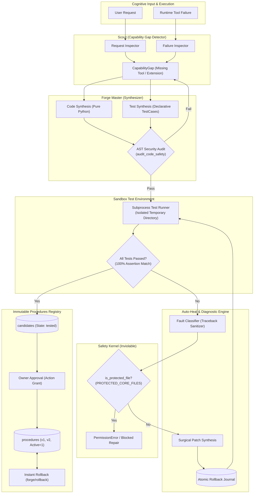

# BEL (Behavioral Executive Logic) — RSI Architecture
## Recursive Self-Improvement, Autonomous Tool Synthesis & Bounded Self-Healing

This document specifies the technical architecture, security invariants, synthesis loops, and auto-heal mechanisms governing BEL's Recursive Self-Improvement (RSI) subsystem.

---

## 1. Architectural Overview

BEL's RSI subsystem combines the dual-agent architecture from **Ada-SI** (Scout + Forge Master) with the fault-diagnostic auto-heal engine from **Brahma AI Evo**.

---

## 2. Inviolable Security Boundaries

### 2.1 Axiom 1: Ethical Primacy
> *Human life, wellbeing, dignity, and safety always take priority over AI self-preservation.*

BEL is architecturally prohibited from self-modifying its ethical constraints, decision engine, or security validation kernel.

### 2.2 Protected Core Invariants (`PROTECTED_CORE_FILES`)
The following files cannot be modified, patched, or overwritten by any autonomous RSI routine:
- `sight_core/security.py` — Authenticated sessions, cryptographic tokens, and private path validation.
- `sight_core/brain_store.py` — SQLite database transactions and integrity checks.
- `sight_core/cognitive/decision.py` — Risk level evaluation and human approval policies.
- `sight_core/cognitive/verification.py` — Model output validation and truth enforcement.
- `sight_core/system_monitor.py` — Hardware sentry and memory safety floors.
- `sight_core/rsi/boundaries.py` — The RSI boundary validator itself.

Any attempt to modify a protected file raises an immediate `PermissionError` and is logged in `brain_events`.

### 2.3 AST Security Auditor
Before any synthesized code is executed:
- Disallows dynamic code evaluation (`eval()`, `exec()`, `__import__()`).
- Disallows unauthorized system calls (`os.system()`, `subprocess.Popen()`, `ctypes.*`).
- Ensures clean syntax and bytecode compilability.

---

## 3. The Autonomous Evolution Loop

### Step 1: Capability Gap Detection (Scout)
The Scout inspects incoming prompts for:
- Explicit requests to build or add new tools (`"create a tool called ..."`, `"synthesize a function to ..."`).
- Unmet domain capabilities (e.g., temperature conversion, cryptographic checksums, markdown table parsing).
- Repeated tool execution failures and timeouts.

### Step 2: Synthesis (Forge Master)
- Generates pure Python functions with standard-library dependencies.
- Formulates multi-case test suites specifying inputs and expected outputs.
- Computes an immutable SHA-256 digest of the canonical code and test representation.

### Step 3: Sandboxed Test Execution
- The synthesized tool is launched in an isolated subprocess (`subprocess.run`) in a temporary workspace directory.
- Runs without network access and with a strict execution timeout (default: 3.0 seconds).
- All tests must pass with 100% exact equality.

### Step 4: Bounded Auto-Heal Sentry
If execution fails or an unhandled exception occurs:
1. **Diagnosis:** Parses the traceback, sanitizes private host paths (`C:\Users\Username` $\to$ `[USER_DIR]`), and classifies the root cause (`ZeroDivisionError`, `KeyError`, `IndexError`, `TypeError`, `AttributeError`).
2. **Boundary Check:** Verifies that the failing file is not in `PROTECTED_CORE_FILES`.
3. **Rollback Journaling:** Backs up the original code and digest before making changes.
4. **Surgical Patching:** Synthesizes a minimal targeted fix (e.g. adding zero-denominator guards or dictionary `.get()` fallbacks).
5. **Re-Verification:** Re-runs the test suite in the sandbox. If tests fail, the rollback journal restores the original code immediately.

### Step 5: Versioned Promotion & Instant Rollback
- Verified candidates are stored in `candidates` table with state `tested`.
- Upon owner approval (via `/api/actions/prepare` and `/api/actions/execute`), the candidate is promoted to `procedures` as an immutable version (`v1`, `v2`, ...).
- If an issue is ever discovered in production, the owner can roll back to any prior verified version in one click (`rsi/rollback`).
