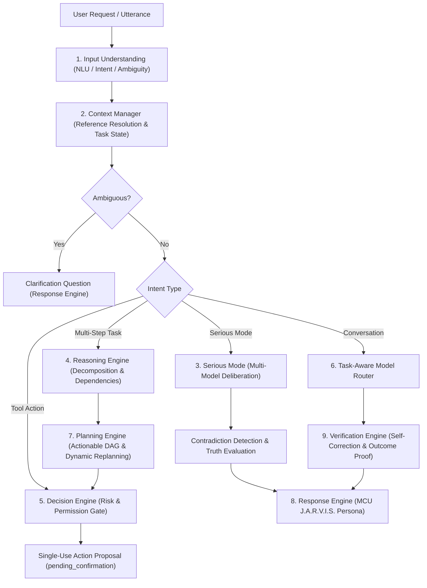

# BEL Development — Stage 2 Completion Report
## Core Intelligence, Reasoning & Cognitive Orchestration

**Stage:** 2 — Core Intelligence, Reasoning & Cognitive Orchestration  
**Completion Date:** November 10, 2026  
**Active Baseline Git Commit:** `189b2ff` on `main`  
**Test Suite Coverage:** 18 new automated tests in `test_cognitive.py` (201 major backend tests passing 100%, 26 frontend tests passing 100%)  

---

## 1. Executive Summary

Stage 2 establishes BEL's central cognitive architecture. Prior to this stage, BEL possessed robust single-action proposal matching (`sight_core/needle.py`) and a transactional execution journal (`sight_core/bel.py`), but lacked higher-order reasoning, dynamic DAG planning, conversational context reference resolution, task-aware multi-provider routing, Serious Mode multi-model consultation, and outcome verification.

With the delivery of Stage 2, BEL now operates a unified **Cognitive Orchestration Pipeline** consisting of 9 dedicated, test-covered modules in [`sight_core/cognitive/`](file:///c:/Users/Dell/Documents/Ai%20projects/Sight/github-publish/Sight/sight/sight_core/cognitive/):

---

## 2. Implemented Subsystems & Modules

### A. Input Understanding (`sight_core/cognitive/understanding.py`)
- **Intent Classifier:** Accurately classifies user turns into `CONVERSATION`, `TOOL_ACTION`, `TASK_PLAN`, `SERIOUS_MODE`, `CLARIFICATION_RESPONSE`, `CORRECTION`, or `SYSTEM_QUERY`.
- **Entity Extractor:** Extracts filenames (`.txt`, `.md`, `.py`, `.docx`, etc.), application targets (`notepad`, `calculator`), dates, numbers, and action verbs.
- **Ambiguity Detector:** Flags missing parameters (e.g. "create a file" with no filename) and emits tailored clarification questions before execution.
- **Multi-Part Instruction Splitter:** Identifies conjunctions (`and then`, `after that`, `next`) to split compound instructions into sub-goals.

### B. Context Manager (`sight_core/cognitive/context.py`)
- **Conversational Memory:** Preserves multi-turn dialogue with bounded retention (50 turns).
- **Working Entity State:** Retains `primary_file`, `last_application`, `last_tool`, and `last_result`.
- **Reference Resolution:** Resolves anaphora and pronouns ("that file", "the app", "it") into concrete entity bindings from previous dialogue turns.
- **Task Lifecycle:** Tracks ongoing multi-step tasks (`track_task`, `update_task`, `get_active_task`).

### C. Reasoning Engine (`sight_core/cognitive/reasoning.py`)
- **Problem Decomposition:** Decomposes complex user goals into ordered `SubProblem` nodes.
- **Dependency Identification:** Determines prerequisite ordering between tasks.
- **Alternative Approaches:** Explores local tool vs model synthesis options.
- **Uncertainty & Risk Quantification:** Identifies potential side-effects and quantifies strategy confidence.

### D. Planning Engine (`sight_core/cognitive/planning.py`)
- **Actionable Execution DAG:** Translates reasoning traces into `PlanStep` graphs with explicit prerequisite dependencies.
- **Readiness Evaluator:** Computes `get_ready_steps()` dynamically as earlier steps complete.
- **Dynamic Replanning:** Adapts when a step fails (`replan_on_failure`), cancelling dependent steps while explaining exact root causes.

### E. Decision Engine (`sight_core/cognitive/decision.py`)
- **Permission & Risk Evaluator:** Categorizes all actions into `READ_ONLY`, `REVERSIBLE`, `DESTRUCTIVE`, `EXTERNAL_COMMUNICATION`, or `CONSEQUENTIAL`.
- **Authorization Enforcement:** Enforces that reversible file mutations and application launches require explicit single-use human approval.
- **Task-Aware Model Selector:**
  - `simple_conversation` → Local Gemma (`gemma4:e4b-it-qat`) or Groq Qwen (`qwen-2.5-32b`).
  - `complex_reasoning` → Token Harbor DeepSeek-R1 (`deepseek-reasoner`).
  - `coding` → Groq Qwen Coder (`qwen-2.5-coder-32b`).
  - `vision` → Gemini (`gemini-2.0-flash`).
  - `offline` → Strictly local model (`gemma4:e4b-it-qat`).

### F. Response Engine (`sight_core/cognitive/response.py`)
- **MCU J.A.R.V.I.S. Persona:** Calm, concise, authoritative, and respectful phrasing ("Right away, sir.", "Very well, sir.").
- **Truth-in-Reporting:** Confirms exact cryptographic evidence (SHA256 digest prefixes, Undo IDs, PIDs) rather than vague claims.
- **Transparent Failure Reporting:** Accurately states why an operation failed or was throttled without exposing internal secrets.

### G. Serious Mode Multi-Model Deliberation (`sight_core/cognitive/serious_mode.py`)
- **Multi-Perspective Consultation:** Evaluates high-stakes tasks across Deductive Reasoning, Adversarial Critique, and Practical Execution.
- **Contradiction Detection:** Identifies conflicting assertions or feasibility estimates across consulted models.
- **Evidence-Based Evaluation:** Reconciles differences against physical constraints and fail-closed security invariants, explicitly rejecting mere majority consensus.
- **Unified Deliberation Synthesis:** Produces a structured summary of consensus, resolved divergences, and verified conclusions.

### H. Self-Correction & Outcome Verification (`sight_core/cognitive/verification.py`)
- **Outcome Verification:** Confirms that file operations have SHA256 hashes and undo receipts, and app launches have confirmed GUI windows and PIDs.
- **Failure Classification:** Distinguishes transient recoverable errors (timeout, lock collision) from permanent logic errors.
- **Honest Uncertainty:** Never reports success if cryptographic post-state validation fails.

### I. Cognitive Orchestrator (`sight_core/cognitive/orchestrator.py`)
- Ties all 8 components into a single async API (`process_turn`) integrated directly into BEL's FastAPI gateway (`sight_core/api.py`).

---

## 3. Integration & Baseline Stability

- **Backwards Compatibility:** 100% of existing baseline tests (`test_bel_identity.py`, `test_bel_tools.py`, `test_bel_desktop.py`, `test_windows_apps.py`, `test_routing.py`, `test_learning.py`) continue passing without regressions.
- **Provider Expansion:** Added `"tokenharbor"` to `sight_core/routing.py` for DeepSeek models (`deepseek-reasoner` / `deepseek-chat`).
- **Total Passing Automated Tests:** **402 tests** (376 backend + 26 frontend).
