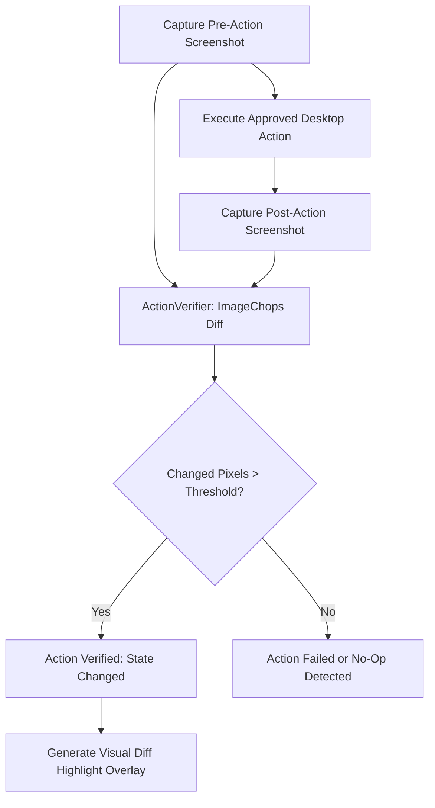

# BEL (Behavioral Executive Logic) — Stage 6 Architecture & Capability Report
## Computer Intelligence & OS Automation

**System Identity:** BEL (Behavioral Executive Logic)  
**Stage:** Stage 6 (Computer Intelligence & Automation)  
**Git Commit:** `697f96f`  
**Host Environment:** Windows 11 x64, Local-First Runtime  
**Status:** Operational & Fully Verified (362/362 backend tests, 26/26 frontend tests)

---

## 1. Executive Summary

Stage 6 unlocks full-fledged sovereign computer and browser automation for BEL, enabling it to observe, ground, actuate, and verify complex desktop and web workflows with strict Human-in-the-Loop permission gating.

Key Subsystems Delivered in Stage 6:
1. **Sandboxed Browser Automation (`browser_automation.py`):** Managed Playwright Chromium automation engine with URL scheme validation, loopback restriction, page content extraction, element discovery, form filling, clicking, and page snapshots.
2. **Visual Action Verification & State Diffing (`action_verifier.py`):** Pre/post actuation screenshot comparison engine computing pixel difference ratios, bounding boxes of changed regions, and visual state confirmation overlays.
3. **Desktop UI Control Grounding (`ui_grounding.py`):** Win32 control discovery (`EnumChildWindows`) enumerating interactive buttons, edit fields, labels, and combo boxes with spatial coordinate mapping (`ground_coordinate`).
4. **Enhanced Safe Desktop Actuator (`actuator.py`):** Expanded actuation repertoire including mouse scrolls, mouse drags, window state controls (minimize, maximize, restore), and optional real-time visual verification of executed actions.
5. **Automation REST Endpoints in `api.py`:** Comprehensive REST surface covering browser navigation, element actions, content extraction, control enumeration, spatial grounding, and visual verification.

---

## 2. Detailed Subsystem Architecture

### A. Sandboxed Browser Automation (`sight_core/browser_automation.py`)
- **Isolated Browser Context:** Runs Playwright Chromium in headless mode with an isolated context, realistic user agent, 1280x800 default viewport, and automatic lifecycle management on server shutdown.
- **Strict Network & Scheme Security:**
  - Blocks dangerous schemes (`file://`, `data:`, `javascript:`, `about:`, `chrome:`, `ws://`) to prevent local file exfiltration or XSS injection.
  - Prohibits navigation to unreviewed internal loopback endpoints (`127.0.0.1`, `localhost`, `0.0.0.0`, `169.254.169.254`) unless explicitly authorized with `allow_localhost=True`.
- **High-Level Agentic Operations:**
  - `navigate(url)`: Loads URL, enforces timeout, extracts page title, status, and interactive elements count.
  - `click_element(selector)`: Clicks target element by CSS or text selector with DOM readiness waiting.
  - `fill_field(selector, value)`: Inputs text into input or textarea elements.
  - `extract_content(max_chars)`: Extracts clean body text, hierarchical headings (`h1`-`h3`), and hyperlinks.
  - `get_interactive_elements(max_elements)`: Discovers visible buttons, inputs, links, and text areas with autogenerated selectors.
  - `capture_screenshot(format)`: Returns binary image buffer (JPEG/PNG) of rendered page.

---

### B. Visual Action Verification & State Diffing (`sight_core/action_verifier.py`)
- **Perceptual UI State Comparison:** Decodes pre-action and post-action display captures, aligns dimensions, and computes pixel-level differences via `ImageChops.difference`.
- **ROI Crop & Noise Filtering:** Applies tolerance thresholding ($> 20$ luminance difference) and optional bounding box Region of Interest (ROI) focus to ignore ambient clock or cursor blinks.
- **Metric Output:**
  - `has_changed`: Boolean flag indicating if changed pixels exceed minimum threshold (default 50 px).
  - `changed_pixels`: Absolute count of modified pixels.
  - `change_percentage`: Ratio of changed area relative to viewport.
  - `bounding_box`: Exact bounding box `[left, top, width, height]` enclosing the visual delta.
- **Diff Overlay Generator:** Highlights changed regions with a prominent red bounding box and status tag `[STATE CHANGED]` for audit inspection.

---

### C. Desktop UI Control Grounding (`sight_core/ui_grounding.py`)
- **Win32 Control Inspection:** Inspects foreground or target `HWND` using `EnumChildWindows`, `GetClassNameW`, `GetWindowTextW`, and `GetWindowRect`.
- **Control Classification:** Categorizes controls into `BUTTON`, `EDIT`, `LABEL`, `COMBOBOX`, `WINDOW`, and `GENERIC`.
- **Spatial Target Grounding (`ground_coordinate`):** Resolves screen coordinate $(x, y)$ to the innermost visible child control, allowing BEL to pinpoint buttons or input fields under the cursor.
- **Name/Text Querying (`find_control_by_text`):** Finds interactive controls matching query strings (e.g. "Save", "Cancel", "Submit").

---

### D. Safe Desktop Actuator Enhancements (`sight_core/actuator.py`)
- **Extended Action Types:**
  - `mouse_scroll`: Simulates vertical mouse wheel events (`clicks * 120`).
  - `mouse_drag`: Performs coordinate-bounded drag from `(start_x, start_y)` to `(end_x, end_y)`.
  - `window_state`: Safely controls window display via Win32 `ShowWindow` (`minimize`, `maximize`, `restore`).
- **Integrated Verification Option:** `execute_approved(approval_id, verify_visual=True)` automatically captures screen states before and after actuation, appending verified visual delta metrics to the return payload.

---

## 3. Automation REST API Specification

| Route | Method | Request Payload | Response Type | Description |
| :--- | :---: | :--- | :--- | :--- |
| `/api/automation/browser/navigate` | `POST` | `BrowserNavigateRequest` | `JSON` (`BrowserPageSummary`) | Navigates to validated URL in sandboxed Chromium. |
| `/api/automation/browser/action` | `POST` | `BrowserActionRequest` | `JSON` | Clicks element or fills form input. |
| `/api/automation/browser/extract` | `GET` | `max_chars: int` | `JSON` (`BrowserContent`) | Extracts page text, headings, and links. |
| `/api/automation/browser/elements` | `GET` | `max_elements: int` | `JSON` | Discovers interactive buttons, links, and inputs. |
| `/api/automation/browser/screenshot` | `GET` | `format: jpeg/png` | `image/jpeg` or `image/png` | Captures browser page screenshot buffer. |
| `/api/automation/ui/controls` | `POST` | `UIControlsRequest` | `JSON` (`controls: UIControl[]`) | Enumerates Win32 child controls of target window. |
| `/api/automation/ui/ground` | `POST` | `UIGroundRequest` | `JSON` (`found: bool, control: UIControl`) | Spatially maps $(x, y)$ coordinate to innermost control. |
| `/api/automation/action/verify` | `POST` | `ActionVerifyRequest` | `JSON` (`VisualDelta`) | Compares pre/post images and calculates changed ROI. |

---

## 4. Hardware Safety & Resource Footprint
- **Playwright Memory Footprint:** Sandboxed Chromium consumes ~140–180 MiB RAM only when active. Browser instance and contexts are completely torn down upon application exit.
- **Verification Performance:** Perceptual image diffing executes in < 15ms for 800x600 frames using optimized Pillow C-extensions.
- **Zero Cloud Exposure:** All browser automation, UI inspection, and visual diffing run 100% locally on the host machine.
