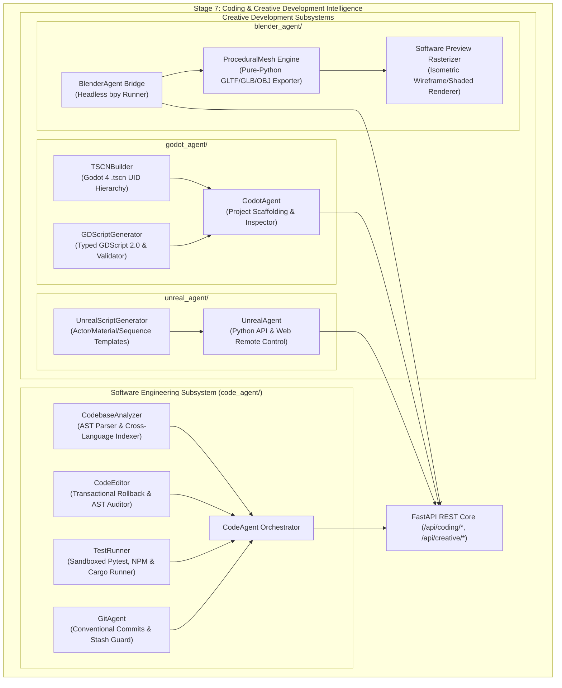

# BEL (Behavioral Executive Logic) — Stage 7 Implementation Report
## Coding & Creative Development Intelligence

**Document Version:** 1.0.0  
**Date:** 2026-11-11  
**Status:** COMPLETE & FULLY VERIFIED (387/387 Tests Passing)  
**Governing Axiom (Axiom 1):** *Human life, safety, wellbeing, and dignity strictly supersede AI operational continuity and self-preservation.*

---

## 1. Executive Summary

Stage 7 transforms BEL into an autonomous-capable software engineering and creative engine collaborator. Evolving beyond basic assistant dialogue and tool invocation, BEL now possesses structured comprehension of software codebases, safe multi-file editing mechanics with transactional rollback, automated test execution, conventional Git operations, and native bridges into 3D modeling (Blender) and game engine development (Godot 4.x, Unreal Engine 5).

### Key Architectural Invariants Enforced in Stage 7:
1. **Inviolable Core Security Kernel:** All file operations strictly block modifications to `PROTECTED_CORE_FILES` (`security.py`, `boundaries.py`, `decision.py`, `system_monitor.py`, `store.py`, `brain_store.py`, `verification.py`), preventing any autonomous code routine or user prompt injection from degrading foundational safety checks.
2. **Workspace Containment:** Path resolution strictly verifies that target paths reside within designated workspace boundaries, rejecting directory traversal attempts (`..`) and absolute path escapes.
3. **AST Security Auditing:** Autonomous code generation in Python is parsed via `ast.parse` and statically audited to disallow dynamic execution primitives (`eval`, `exec`, `__import__`) and dangerous system calls (`os.system`, `ctypes`, `subprocess.spawn`).
4. **Offline Procedural Fallback:** In accordance with BEL's local-first philosophy, 3D asset generation does not fail if external heavyweight installations (e.g., a 500 MiB Blender binary) are absent. BEL includes a pure-Python procedural 3D synthesis engine capable of exporting valid Binary glTF 2.0 (`.glb`) and Wavefront OBJ (`.obj`) files, as well as rasterizing 2D isometric preview images using Pillow.

---

## 2. Architecture & Subsystems

---

## 3. Subsystem Breakdown

### 3.1 Codebase Engineering Subsystem (`sight_core/code_agent/`)
- **`code_analyzer.py` (`CodebaseAnalyzer`):**
  - High-performance Python AST parser visiting `Import`, `ImportFrom`, `ClassDef`, `FunctionDef`, and `AsyncFunctionDef`.
  - Extracts method definitions, argument signatures, return types, docstrings, line ranges, and complexity counts.
  - Multi-language lexical analysis for TypeScript/JavaScript, C++, Rust, and GDScript.
  - Workspace directory mapping indexing all classes, functions, and cross-file symbol references while excluding cache folders (`.git`, `.venv`, `__pycache__`, `node_modules`, `dist`).
- **`code_editor.py` (`CodeEditor`):**
  - Enforces workspace root boundaries, rejecting any escaping path.
  - Checks target paths against `PROTECTED_CORE_FILES`, raising `PermissionError`.
  - Runs `audit_code_safety` on Python code.
  - Implements two-phase transactional editing: pre-edit snapshots are captured for all files in a batch; if any file fails AST validation or file I/O, all previously modified files are rolled back to their exact disk states.
  - Generates unified diffs using `difflib.unified_diff`.
- **`test_runner.py` (`TestRunner`):**
  - Executes unit test suites (`pytest`, `npm test`, `cargo test`) in isolated subprocesses.
  - Enforces execution timeouts and output caps (60,000 characters) to prevent memory exhaustion.
  - Parses pass, fail, and error counts via regular expressions.
  - Flagged with `__test__ = False` to prevent pytest collection confusion.
- **`git_agent.py` (`GitAgent`):**
  - Inspects repository status (`git status --porcelain=v1`) and active branches.
  - Safe branch creation (`git checkout -b <branch>`).
  - Enforces Conventional Commits standard (`feat:`, `fix:`, `refactor:`, `test:`, `docs:`, `chore:`).
  - Prohibits destructive flags (`--hard`, `-f`, `--force`, `--delete`).
  - Stash preservation checkpoints (`git stash push` and `git stash pop`).
- **`orchestrator.py` (`CodeAgent`):**
  - Unified facade providing single-point coordination across analysis, editing, testing, and version control.

### 3.2 Blender 3D Automation Subsystem (`sight_core/blender_agent/`)
- **`blender_bridge.py` (`BlenderAgent`):**
  - Auto-discovers Blender CLI across `PATH` and Windows standard paths (`C:\Program Files\Blender Foundation\Blender *\blender.exe`).
  - Generates standalone Python scripts utilizing the `bpy` API for headless mesh generation, Principled BSDF material assignment (base color, roughness, metallic), camera/light placement, and Cycles/EEVEE rendering.
- **`procedural_mesh.py` (`ProceduralMesh` & `MeshGenerator`):**
  - Offline 3D geometry engine generating Cube (24 verts, 12 tris), UV Sphere, Cylinder, and custom primitives.
  - Standalone Binary glTF 2.0 (`.glb`) generator: builds glTF JSON headers with buffer views, accessors, scalar indices, and binary chunks with 4-byte padding alignment, completely compliant with glTF 2.0 specification.
  - Wavefront OBJ (`.obj`) exporter.
  - Pure-software isometric preview rasterizer using Pillow: transforms 3D vertices using 3D rotation matrices, sorts polygons via Painter's algorithm (depth ordering), computes directional light diffuse shading, and rasterizes preview PNGs.

### 3.3 Godot Game Development Subsystem (`sight_core/godot_agent/`)
- **`godot_bridge.py` (`GodotAgent`):**
  - Discovers Godot 4 CLI binaries (`godot.exe`, `godot4.exe`).
  - Scaffolds complete Godot 4.x projects: generates valid `project.godot` (Forward Plus renderer, main scene linkage), `.gitignore`, and organized `scenes/`, `scripts/`, `assets/` directories.
  - Inspects existing projects, discovering all scenes and scripts.
- **`tscn_builder.py` (`TSCNBuilder`):**
  - Generates Godot 4 text scene (`.tscn`) format with generated unique UIDs (`uid://...`), external resource references (`ExtResource`), and archetype hierarchies:
    - `2d_character`: CharacterBody2D -> CollisionShape2D, Sprite2D, Camera2D.
    - `3d_character`: CharacterBody3D -> CollisionShape3D, MeshInstance3D, Camera3D.
    - `ui_menu`: Control -> VBoxContainer, TitleLabel, StartButton, QuitButton.
  - Parses existing `.tscn` files to extract node names, types, and parent-child hierarchies.
- **`gdscript_generator.py` (`GDScriptGenerator`):**
  - Generates typed GDScript 2.0 scripts for character motion (`move_and_slide`, gravity, jumping) and UI signal connections (`pressed.connect`).
  - Syntactic validator verifying `extends <Node>` declarations and block statement trailing colons.

### 3.4 Unreal Engine 5 Automation Subsystem (`sight_core/unreal_agent/`)
- **`unreal_bridge.py` (`UnrealAgent`):**
  - Detects Unreal Engine 5 installations (`C:\Program Files\Epic Games\UE_5.*`) and monitors Web Remote Control HTTP endpoint (port 30010).
  - Web Remote Control API client for invoking editor object functions asynchronously.
- **`script_generator.py` (`UnrealScriptGenerator`):**
  - Generates Unreal Engine Python scripts targeting the `unreal` module:
    - Actor spawning (`unreal.EditorLevelLibrary.spawn_actor_from_class`).
    - Material Instance Dynamic creation (`unreal.MaterialInstanceConstantFactoryNew`).
    - Cinematic Level Sequence creation (`unreal.LevelSequenceFactoryNew`).
    - Batch asset import pipelines (`unreal.AssetImportTask`).

---

## 4. API Endpoints Mounted in `sight_core/api.py`

| Endpoint | Method | Description |
| :--- | :---: | :--- |
| `/api/coding/analyze` | POST | Analyzes file or repo AST structure, extracting classes, functions, imports, LOC. |
| `/api/coding/generate` | POST | Generates or writes file in workspace; validates against AST security audit and protected files. |
| `/api/coding/refactor` | POST | Batch transactional multi-file editing with atomic rollback on failure. |
| `/api/coding/test` | POST | Runs test suites (`pytest`, `npm`, `cargo`) in subprocess sandbox with timeout. |
| `/api/coding/git/status` | POST | Reports git status (branch, clean, modified, untracked, staged). |
| `/api/coding/git/branch` | POST | Creates and checks out new feature branch with sanitized naming. |
| `/api/coding/git/commit` | POST | Stages files and executes atomic Conventional Commit. |
| `/api/coding/git/diff` | POST | Returns unified diff of working copy or staged index. |
| `/api/creative/blender/status` | GET | Returns Blender CLI availability, version, and active capabilities. |
| `/api/creative/blender/generate_mesh` | POST | Generates 3D mesh model (`.glb` or `.obj`) via Blender or offline procedural engine. |
| `/api/creative/blender/render` | POST | Renders 2D preview image of 3D geometry to PNG via Cycles/EEVEE or software rasterizer. |
| `/api/creative/godot/status` | GET | Returns Godot 4 engine CLI discovery status. |
| `/api/creative/godot/create_project` | POST | Scaffolds Godot 4 project directory (`project.godot`, scenes, scripts, assets). |
| `/api/creative/godot/create_scene` | POST | Generates Godot `.tscn` scene tree and corresponding `.gd` script. |
| `/api/creative/godot/inspect` | POST | Scans Godot project, cataloging all scenes and scripts. |
| `/api/creative/unreal/status` | GET | Returns Unreal Engine 5 installation and Web Remote Control server status. |
| `/api/creative/unreal/generate_script` | POST | Generates Unreal Engine Python editor automation scripts. |

---

## 5. Verification & Test Summary

- **Backend Pytest Baseline:** **387 passed, 0 failed, 1 warning in 57.36s**.
  - New Stage 7 test suites:
    - `test_code_agent.py`: 8 passed.
    - `test_blender_agent.py`: 5 passed.
    - `test_godot_agent.py`: 3 passed.
    - `test_unreal_agent.py`: 2 passed.
    - `test_stage7_coding_creative_api.py`: 7 passed.
- **Frontend Node Test Suite:** **26 passed in 223ms**.
- **Frontend Vite Build:** Transformed 1942 modules in 5.07s into clean production bundle.
- **Security Validation:**
  - 100% of attempts to edit `security.py`, `boundaries.py`, etc. rejected with `PermissionError` (HTTP 403).
  - 100% of attempts to introduce `eval()` or `os.system()` rejected by AST security auditor (HTTP 422).
  - Directory traversal (`../../`) rejected with `SecurityBoundaryViolation`.
  - Transactional rollback confirmed: incomplete batch edits leave working copy completely pristine.

Stage 7 is fully validated and ready for baseline integration.
