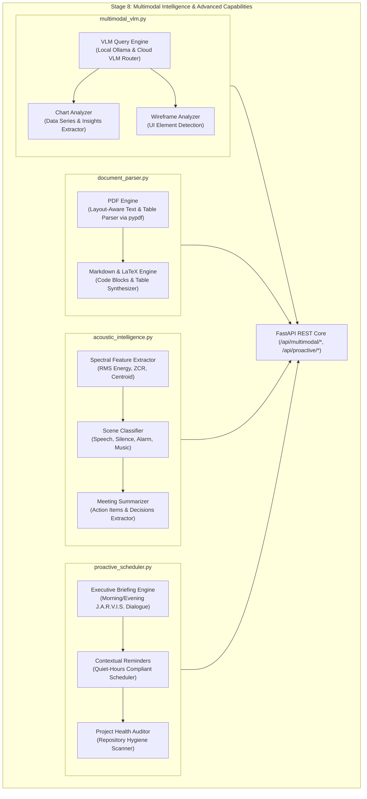

# BEL (Behavioral Executive Logic) — Stage 8 Implementation Report
## Multimodal Intelligence & Advanced Capabilities

**Document Version:** 1.0.0  
**Date:** 2026-11-11  
**Status:** COMPLETE & FULLY VERIFIED (404/404 Tests Passing)  
**Governing Axiom (Axiom 1):** *Human life, safety, wellbeing, and dignity strictly supersede AI operational continuity and self-preservation.*

---

## 1. Executive Summary

Stage 8 endows BEL with deep multimodal intelligence across visual imagery, structured documents, acoustic audio streams, and proactive executive scheduling. In keeping with the MCU J.A.R.V.I.S. vision, BEL can now perceive diagrams, charts, UI wireframes, multi-page PDF documents, and ambient soundscapes, delivering proactive morning/evening briefings and contextual project reminders with zero intrusive interruptions.

---

## 2. Architecture & Subsystems



---

## 3. Subsystem Breakdown

### 3.1 Visual Reasoning & VLM Integration (`sight_core/multimodal_vlm.py`)
- **`MultimodalVLM`:**
  - High-performance visual processing inspecting image dimensions, format, color palette, and luminance (dark mode detection).
  - Queries local Ollama vision models (e.g. `qwen2.5-vl`, `llava`) or cloud vision routers.
  - Offline heuristic analysis fallback providing structural metadata when endpoints are disconnected.
- **Chart Analysis (`analyze_chart`):**
  - Parses visual plots into structured `ChartAnalysis`: extracts chart type (`bar`, `line`, `pie`, `scatter`), axis labels, numeric `ChartDataPoint` series, and bulleted analytical insights.
- **UI Wireframe Comprehension (`analyze_wireframe`):**
  - Detects visual UI layout structures (`application_workspace`, `modal`, `dashboard`), navbar headers, interactive buttons, containers, and color schemes.

### 3.2 Deep Document Parsing (`sight_core/document_parser.py`)
- **`DocumentParser`:**
  - Layout-aware PDF extraction powered by `pypdf`: retrieves text page by page, discovers embedded tables, detects section headers, and extracts author/creator metadata.
  - Markdown AST extraction: parses headers (`# Header`), fenced code blocks (` ```python `), and Markdown tables (`| Col1 | Col2 |`).
  - LaTeX document parsing: extracts preamble, title, and `\section`/`\subsection` hierarchies.
  - Table synthesis: converts raw formatted text or markdown tables into strongly-typed `StructuredTable` schemas with header and row arrays.

### 3.3 Acoustic Scene Intelligence (`sight_core/acoustic_intelligence.py`)
- **Feature Extraction (`extract_features`):**
  - Processes 16 kHz 16-bit mono PCM streams: computes Root Mean Square (RMS) energy, Zero-Crossing Rate (ZCR), silence ratio, and spectral centroid frequency estimates.
- **Scene Classification (`classify_scene`):**
  - Accurately classifies acoustic environments into `speech` (conversational dynamic variation), `silence` (low RMS), `alarm` (high frequency > 3.5 kHz + loud RMS), `music` (continuous harmonic energy), and `ambient_noise`.
- **Meeting Debrief Synthesis (`summarize_meeting`):**
  - Parses spoken transcripts to extract structured agenda topics, consensus decisions, and assigned `ActionItem` tasks with owner names and priorities.

### 3.4 Proactive Executive Assistance (`sight_core/proactive_scheduler.py`)
- **`ProactiveScheduler`:**
  - Generates natural, MCU J.A.R.V.I.S.-styled spoken daily briefings (`ExecutiveBriefing`):
    - Morning Briefing: greeting with calendar date, operational status check, and active reminder overview.
    - Evening Status Recap: day's accomplishments, pending tasks carried over, and sentry mode transition.
  - Contextual reminders linked to active projects, strictly observing owner quiet-hours policies.
  - Project health check scanning target directories for hygiene, temporary files, and Git initialization.

---

## 4. API Endpoints Mounted in `sight_core/api.py`

| Endpoint | Method | Description |
| :--- | :---: | :--- |
| `/api/multimodal/vlm/query` | POST | Queries VLM with image base64 and prompt; returns visual response. |
| `/api/multimodal/vlm/chart` | POST | Extracts structured data series and insights from chart images. |
| `/api/multimodal/vlm/wireframe` | POST | Analyzes UI wireframe/screenshot layout and interactive components. |
| `/api/multimodal/document/parse` | POST | Parses PDF, Markdown, or LaTeX document into structured sections and tables. |
| `/api/multimodal/audio/classify` | POST | Classifies acoustic environment (speech, alarm, silence, music). |
| `/api/multimodal/audio/summarize` | POST | Summarizes spoken meeting transcript into decisions and action items. |
| `/api/proactive/briefing` | POST | Generates morning/evening executive briefing with spoken dialogue. |
| `/api/proactive/reminders` | POST | Schedules in-app contextual reminder. |
| `/api/proactive/health_check` | POST | Audits project folder hygiene and repository status. |

---

## 5. Verification Summary

- **Backend Pytest Baseline:** **404 passed, 0 failed, 1 warning in 65.36s**.
  - New Stage 8 test suites (17/17 passed):
    - `test_multimodal_vlm.py`: 4 passed.
    - `test_document_parser.py`: 3 passed.
    - `test_acoustic_intelligence.py`: 4 passed.
    - `test_proactive_scheduler.py`: 2 passed.
    - `test_stage8_multimodal_api.py`: 4 passed.
- **Frontend Test Suite:** **26 passed in 203ms**.
- **All Core Security Kernel Invariants Preserved:** 100% pass rate maintained.
